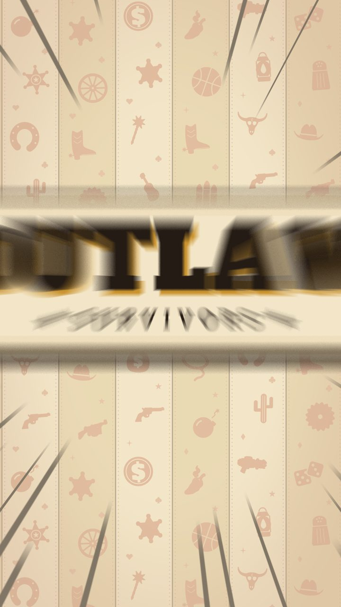
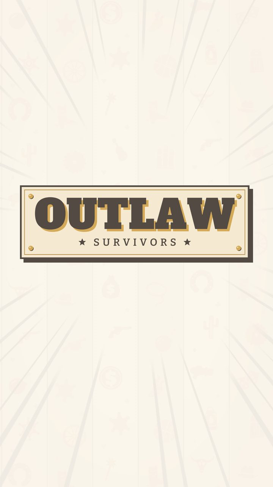
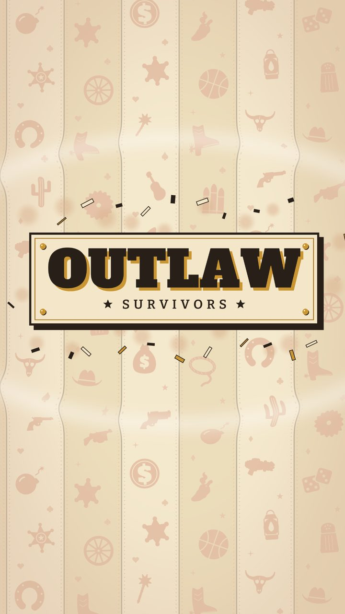
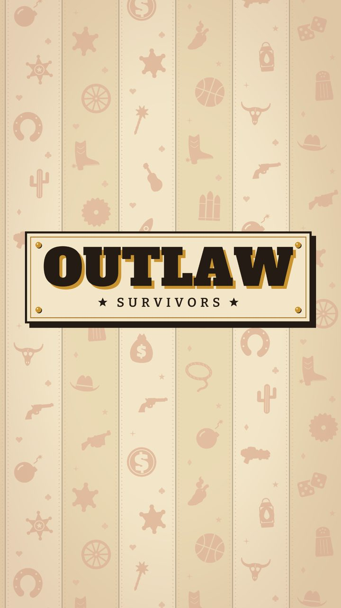

# 00b · Loading screen

**When it shows:** on launch, before the title (about 1.2 s on a PC; it waits longer while a slow phone loads).

**Its job:** Show that the game is loading, with no icon and no progress bar, and introduce the game's name with a hit.

**On it now:**

- Godot's splash and Android's are the plain paper; the first frame here is the same paper.
- Saloon wallpaper (pass 118): six vertical strips in two paper tones with pinstripes and beads, printed tone-on-tone with silhouettes (revolvers, sheriff stars, bombs, boots and other western and game items). The strips scroll in turn up and down while the whole set drifts right: that motion is the loading indicator, and it stops only if the title cannot load.
- The title slam (pass 119; it replaced pass 118's drop, squash and bounce): at 0.3 s the OUTLAW / SURVIVORS plate punches in from 2.6 times its size to its own in 0.12 s, faster and faster, zoom-blurred, with ink speed lines closing in on it, and stops dead.
- The hit: a white impact frame held 0.05 s (a hit-stop) with the plate dark on it, then a 0.3 s screen shake, a shockwave ring bending the wallpaper, dust and ink, brass and paper chips knocked off the plate's edges, and a stamp thud over a low boom.
- A brass glint sweeps across the letters; once it is over the title is built under the screen, which dissolves into it (0.25 s), never before 1.15 s.

**Must still do (how is open):**

- Something moves the whole time the game loads.
- The game's name, once.
- A failed load says so: 'The title screen did not load. Please close the game and start it again.'

**We suspect:**

- The plate's OUTLAW rests mid-screen and the title's own logo near the top: two OUTLAWs cross-fade during the dissolve.

**A question for you:**

- Should the slam land where the title's logo sits, so the hand-over keeps one logo?
