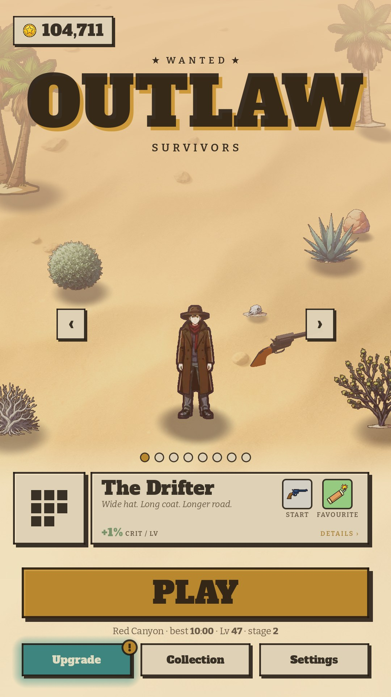
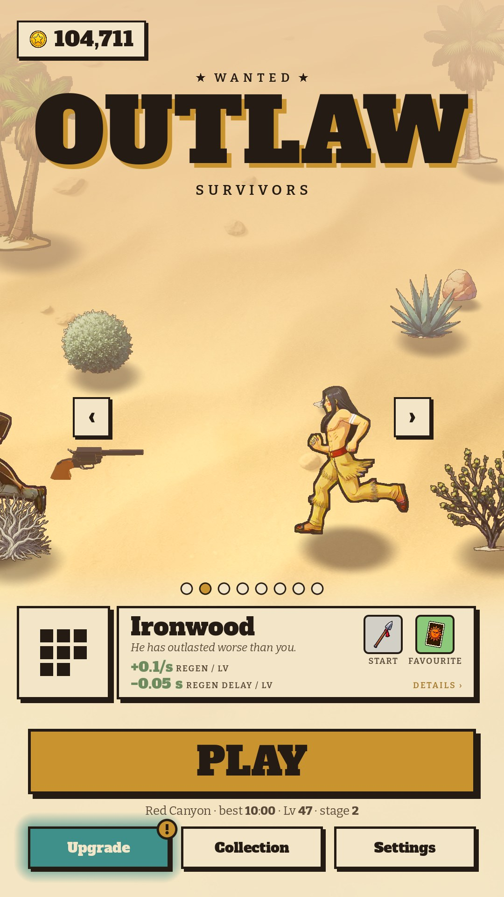
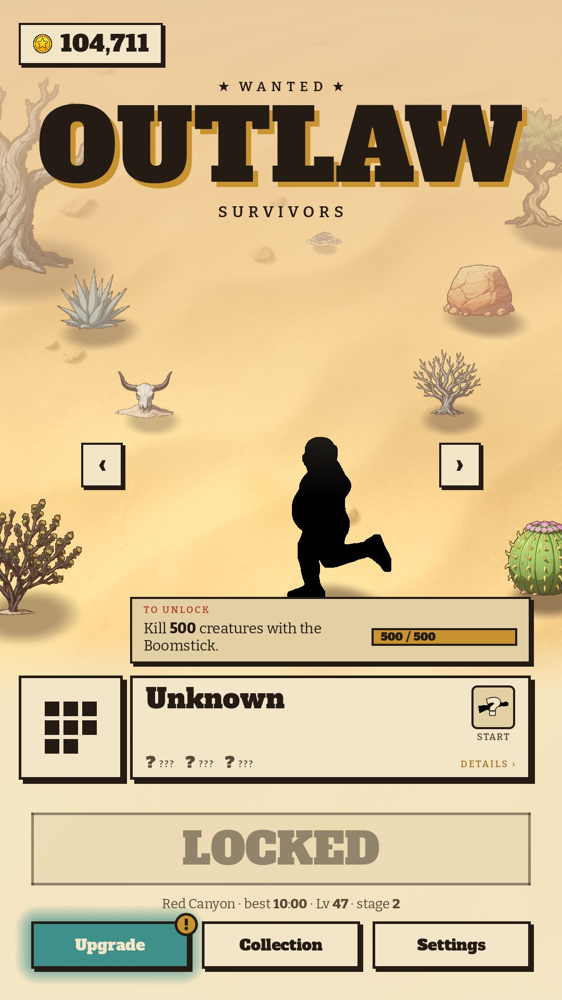

# 01 · Title

**When it shows:** on launch, and back from every hub screen and from Results.

**Its job:** Pick a hero and start a run in one tap; reach the Upgrade board, the Collection and Settings.

**On it now:**

- Top left the purse: a gold plate with a coin and the banked gold.
- The star line 'Wanted', the logo OUTLAW / SURVIVORS (the game's name on screen since pass 115) and 'Drag · Dodge · Survive'.
- The hero standing in the map itself, drawn as a run draws him, his start weapon's companion circling him; arrow squares either side and a swipe change hero (he runs in from the side the finger went); a dot per hero under him.
- The hero plaque: his name, a two-line flavour, up to three trait numbers (HP, SPEED, CRIT / LV ...), the START weapon and FAVOURITE item plates. A tap opens his Wanted-poster sheet; the square at its left opens the hero drawer.
- A hero on sale (his quest done, not bought): a BUY · <price> column over him; a tap asks 'Buy this hero?'.
- A locked hero: a black silhouette named 'Unknown', '?' for every number and plate, a padlock, and a 'To unlock' card with his quest and a progress bar; PLAY reads LOCKED.
- PLAY, the map line under it ('Red Canyon · best 7:10 · Lv 22 · stage 1 · 1,234 kills'), then Upgrade (turquoise, glowing, a brass '!' when a rank is affordable), Collection and Settings.
- Only in a tester's debug mode: ARENA top right. The first launch shows the play-data question over it (see its page).

**Must still do (how is open):**

- One tap to play with the last hero.
- Change hero, see who is locked and how to get him, buy one.
- Reach the Upgrade board, Collection and Settings.
- The purse.

**We suspect:**

- The plaque packs name, flavour, numbers and two plates into 200 px: hard to read at arm's length.
- Three ways to look at heroes (the carousel, the drawer, the sheet) may be one too many.

**A question for you:**

- Should the hero carousel and the hero drawer be one thing?
