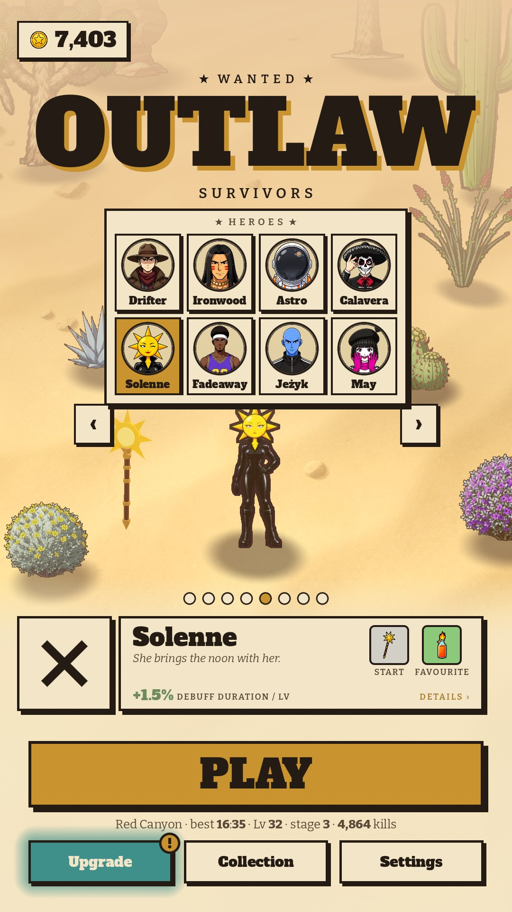

# 02 · Hero drawer

**When it shows:** the square left of the title's hero plaque.

**Its job:** See every hero at once and jump to one.

**On it now:**

- Every hero that is not hidden as a badge tile in two rows, each in the look he is played in, the shown one framed.
- A hero not owned: a black silhouette badge with '?' on an aged tile, his price with a coin under it (on sale) or 'Locked'.
- While it is open the square's glyph is a close X; the title's swipe is off (the drawer takes sideways drags); it scrolls when the heroes do not fit.

**Must still do (how is open):**

- Every hero, owned or not, in the carousel's order.
- Pick one in a tap.

**We suspect:**

- It covers the hero it is meant to choose.
