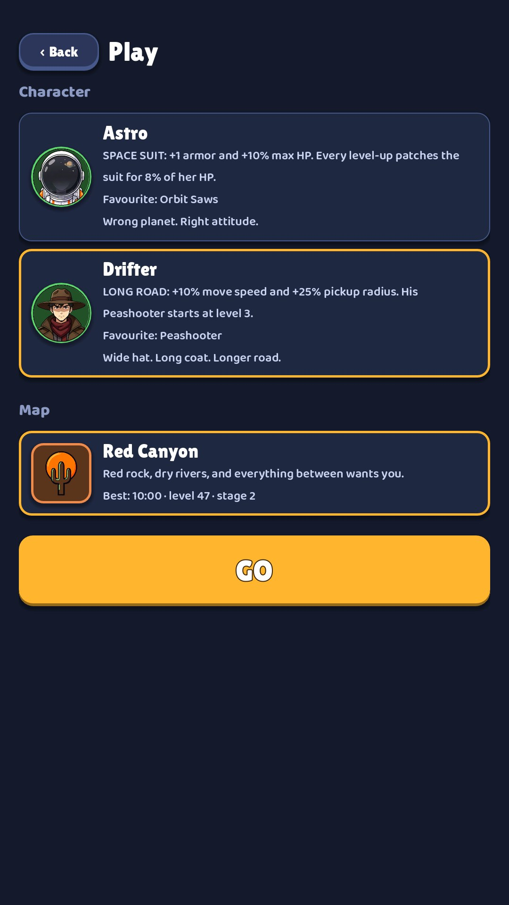

# 02 · Play setup

**When it shows:** from the title's hero chip.

**Its job:** Choose a hero and a map, then go.

**On it now:**

- Back and the title Play.
- Character: a card per hero with a round portrait, the name, the hero's trait in capitals (SPACE SUIT: +1 armor and +10% max HP. Every level-up patches the suit for 8% of her HP.), the favourite weapon and a flavour line. The chosen hero has a gold border.
- Map: one card, Red Canyon, with its flavour line and the best run on it (Best: 10:00 · level 14 · stage 2).
- GO, a big gold button. The lower half of the screen is empty.
- Two heroes can be played today; three more exist and are hidden for now. A locked hero would show its unlock quest.

**Must still do (how is open):**

- Pick a hero, see what makes the hero different (the trait and the favourite weapon).
- Pick a map.
- Go.

**We suspect:**

- It reads like a settings form. The heroes are small badges beside a paragraph.
- Half the screen is empty. The screen may not need to exist on its own (see the title).

**A question for you:**

- How would you show two heroes that play differently (armour and healing against speed and pickup range) at a glance?
