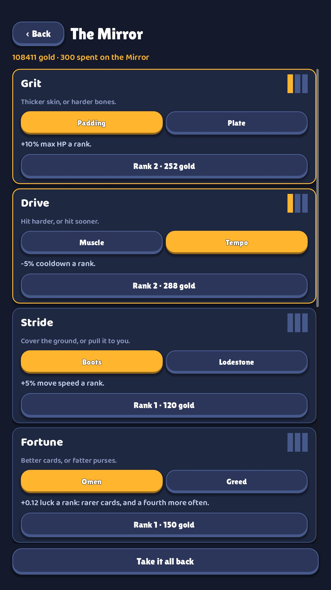
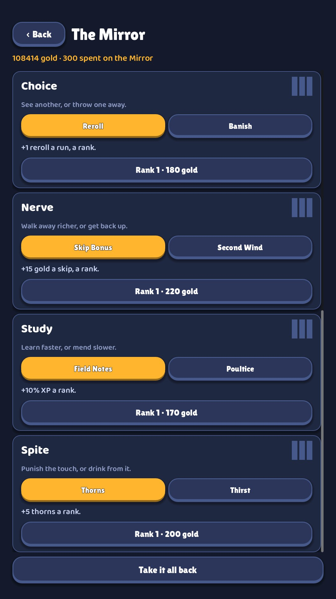

# 03 · The Mirror

**When it shows:** between runs, from the title and from the results.

**Its job:** Spend gold on permanent talents between runs.

**On it now:**

- Back, the title, and a line in gold: 106382 gold · 300 spent on the Mirror.
- Eight talent cards, one under another (Grit, Drive, Stride, Fortune, Choice, Nerve, Study, Spite). Each has the talent's name, three rank bars at the top right, a one-line subtitle (Thicker skin, or harder bones.), two form buttons with the chosen one in gold (Padding / Plate), the chosen form's effect (+10% max HP a rank.) and a button for the next rank (Rank 2 · 252 gold).
- Take it all back, at the bottom: empties the board and returns every coin.

**Must still do (how is open):**

- All eight talents, each with its two forms, its three ranks and the price of the next rank.
- Switching form is free and keeps the ranks; the refund returns everything.

**We suspect:**

- Eight near-identical tall cards; the thing that matters (what a talent does) is the smallest text.
- The rank bars read as a signal-strength icon.
- It has no identity. The idea comes from the Mirror of Night in Hades: a mirror, a face in it, a gold frame could carry the screen.

**A question for you:**

- Could the whole board fit on one screen without scrolling?
