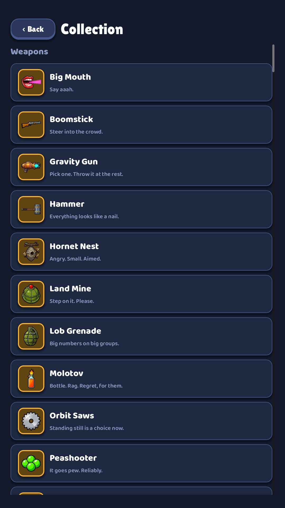
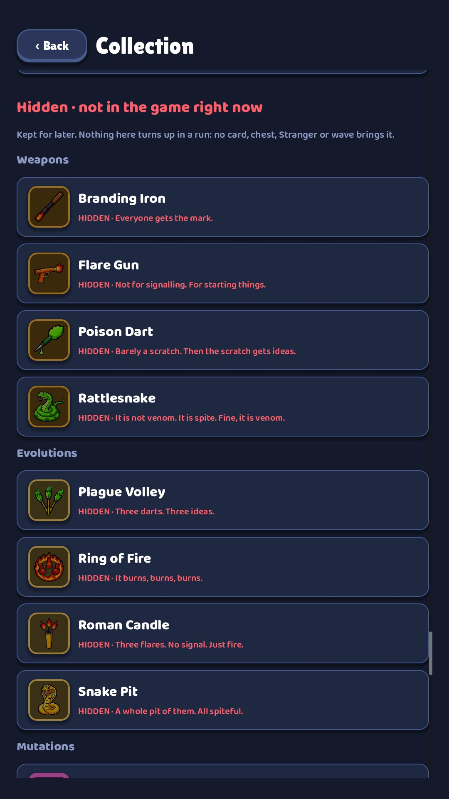

# 04 · Collection

**When it shows:** between runs, from the title.

**Its job:** Everything in the game in one book: what each thing does, and how to unlock what is locked.

**On it now:**

- One long list in sections: Weapons, Evolutions, Passives, Mutations (62 of them), Lines, Hero perks, Characters, Enemies.
- Each row: the icon in a frame, the name and the flavour line. A tap opens the row to show the generated description.
- Locked rows are dimmed and show their unlock quest; an unmet creature shows ??? and Not met yet.
- At the end, a separate part: Hidden · not in the game right now. Weapons, evolutions, mutations, creatures and heroes kept for later, marked HIDDEN in red (second screenshot).
- At the very bottom: N / M unlocks done · K kills all time.

**Must still do (how is open):**

- Every item with its icon, name and description.
- How to unlock what is locked.
- The hidden part, kept apart from the rest.

**We suspect:**

- It is one scroll of more than 150 rows, with no tabs, filters or counts.
- The rows show the flavour line, not what the item does.
- The mutations swamp the list.

**A question for you:**

- Tabs by kind, a grid of icons, per-weapon pages that hold the weapon's mutations and evolution?
