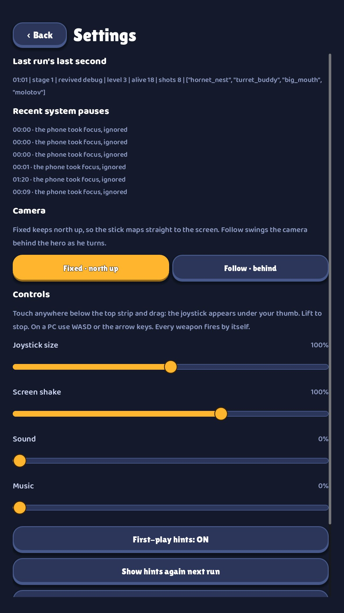
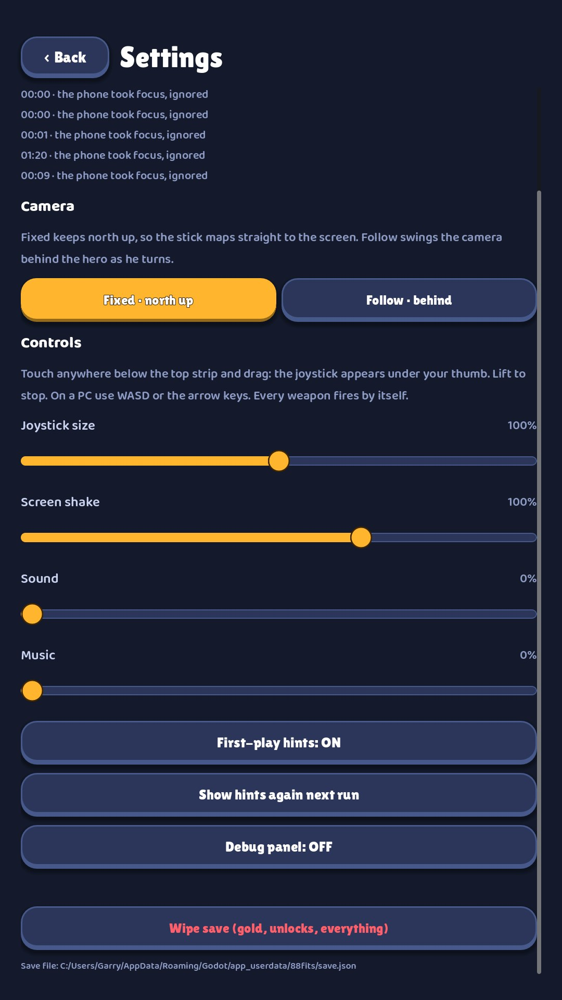

# 05 · Settings

**When it shows:** from the title.

**Its job:** Camera, controls, sound, hints, and wiping the save.

**On it now:**

- Last run's last second: a line of debug output.
- Recent system pauses: six lines of debug output.
- Camera: Fixed · north up, or Follow · behind, with an explanation.
- Controls: an explanation of the joystick, then sliders for joystick size, screen shake, sound and music.
- First-play hints: ON, Show hints again next run, Debug panel: OFF.
- Wipe save (gold, unlocks, everything) in red, and the save file's path.

**Must still do (how is open):**

- Camera mode, joystick size, screen shake, sound, music, hints, wipe save.

**We suspect:**

- It opens on debug output.
- Toggles are drawn as buttons whose label holds the state.
- The slider labels and values are small.
