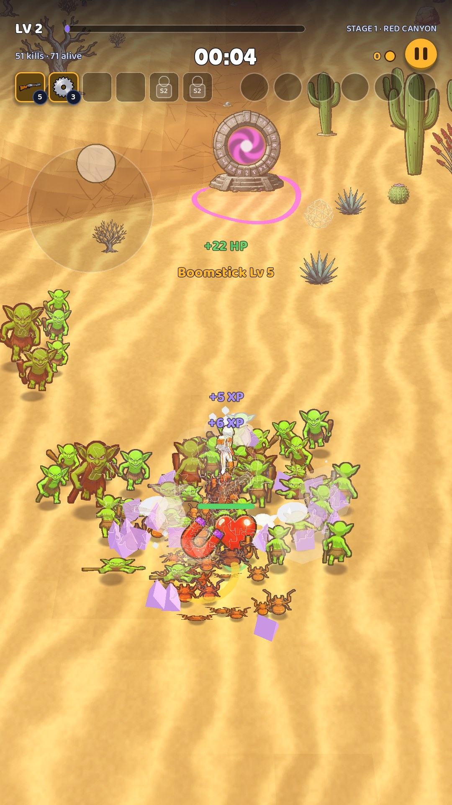
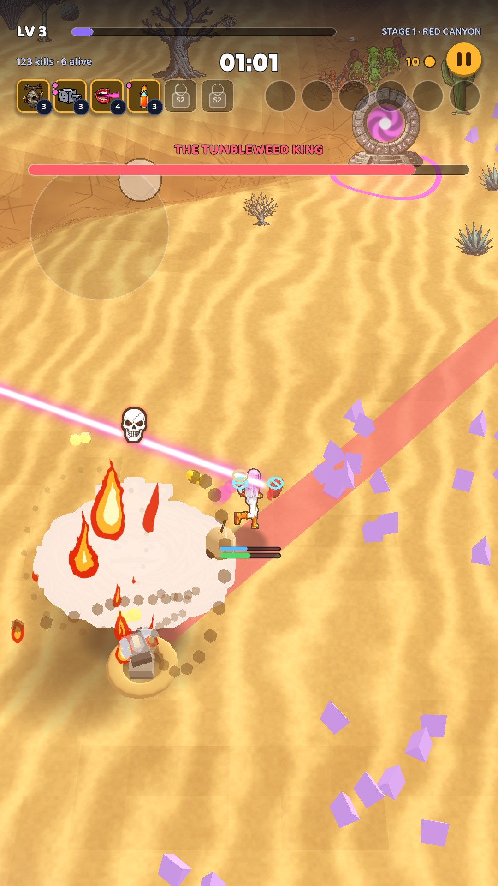
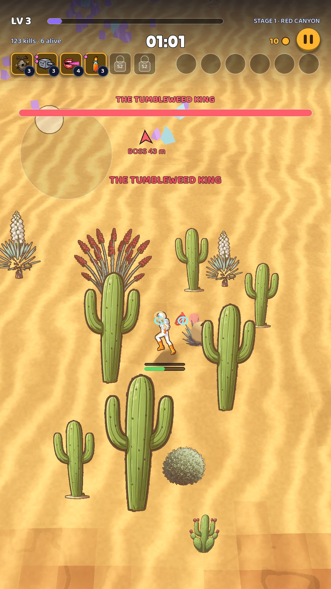

# 06 · In-run HUD

**When it shows:** the whole run.

**Its job:** Show the run at a glance while the thumb steers: level, time, gold, the build, the boss, the hero's health.

**On it now:**

- The top strip (250 px): LV 3 and the XP bar with STAGE 1 · RED CANYON; 106 kills · 6 alive; the big timer 01:01; gold with a coin; the round gold pause button.
- Under that, six weapon slots (square icons with level badges; slots that open in a later stage show a padlock and S2) and six passive slots (round).
- When a boss is up: its name and a long red bar under the strip, and its name again over it in the world. When it is off screen, a red chevron at the edge with the distance (BOSS 44 m); the portal gets a green one, the Elite an orange one.
- Toasts in the middle of the screen: +22 HP, Deadeye Lv 1, HOOKED!, SUPPLY DROP.
- Under the hero, his health bar and a blue shield bar. The joystick ring appears wherever the thumb lands.
- The world: violet XP gems, gold coins, red danger marks on the ground.

**Must still do (how is open):**

- Level and XP, the timer, gold, pause, the build at a glance, the boss's health, the hero's health and shield.

**We suspect:**

- The strip carries more than twenty elements; the slots are small (about 60 px).
- Text drawn over the world loses contrast on bright sand.
- Toasts land in the middle of the action.

**A question for you:**

- What would you take out of the strip altogether?
