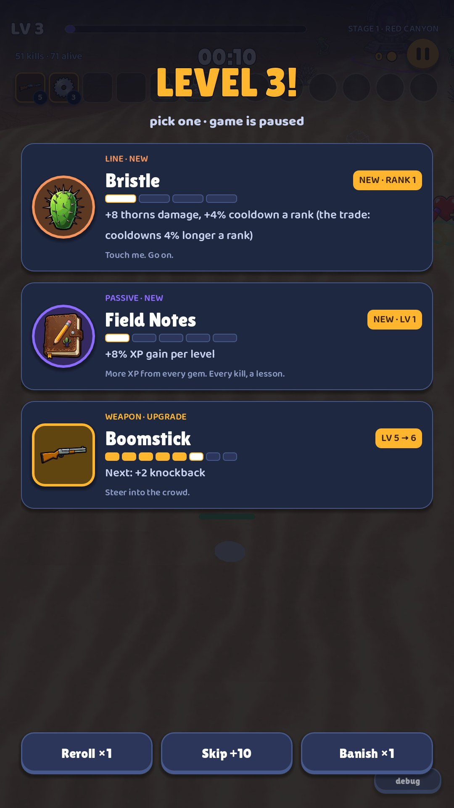
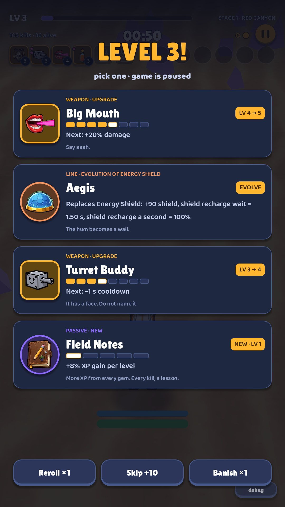

# 07 · Level-up cards

**When it shows:** every level-up (every 20 to 40 seconds early in a run).

**Its job:** Pick one of three or four upgrades, quickly, with the run paused.

**On it now:**

- LEVEL 3! and pick one · game is paused.
- Three or four full-width cards. Each has the icon in a frame of its kind's colour; a kind tag (PASSIVE · NEW, WEAPON · UPGRADE, LINE · EVOLUTION OF ENERGY SHIELD); the name; a chip (NEW · LV 1, LV 3 → 4, EVOLVE); level pips; what it does (+25% pickup radius per level); and a flavour line.
- At the bottom: Reroll ×1, Skip +10 (skipping pays 10 gold), Banish ×1 (removes one card for the rest of the run). A small debug button (developer only).
- The second screenshot shows an evolved line card (Aegis) among ordinary ones.

**Must still do (how is open):**

- Three or four choices with icon, name, what it does and how far along it is.
- Reroll, skip (pays gold) and banish, with how many are left.

**We suspect:**

- Each card is text-heavy; the kind tags are jargon.
- The lower half is empty and the three bottom buttons look alike.

**A question for you:**

- How would you make the right pick obvious in under two seconds?
