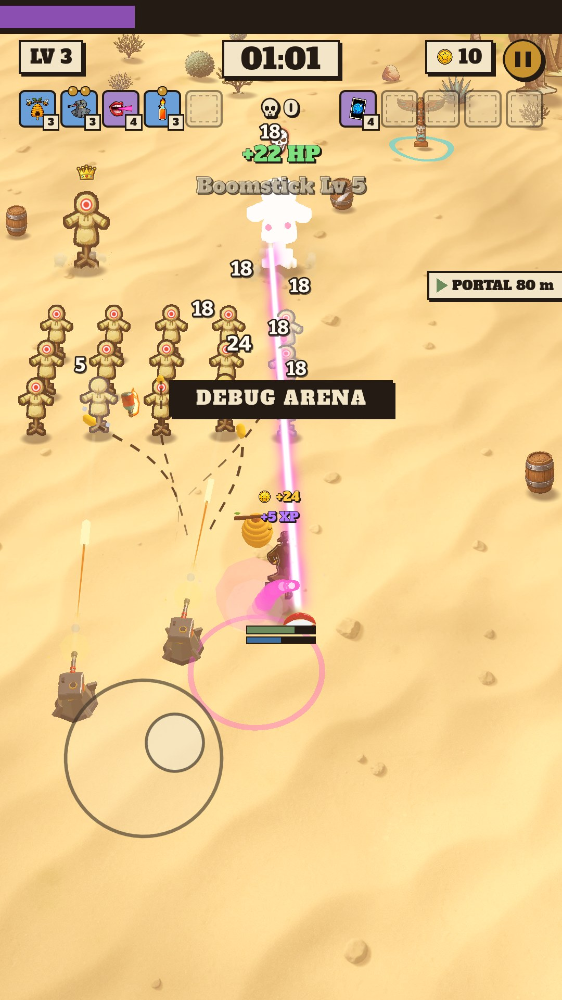
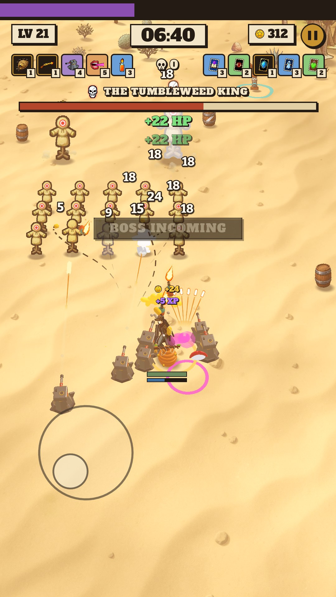
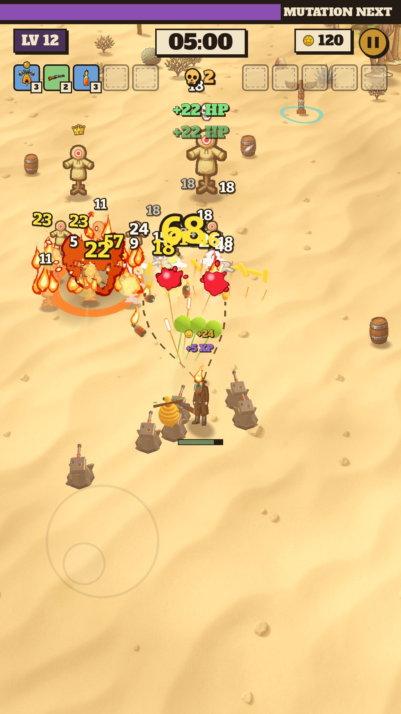
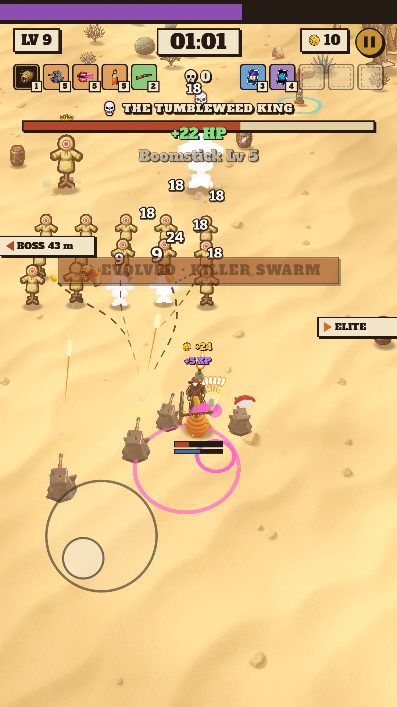
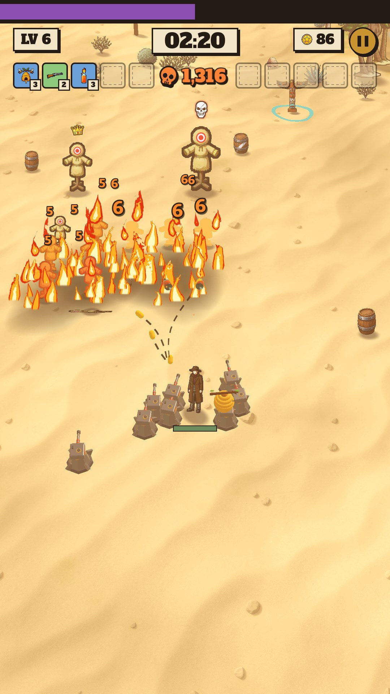
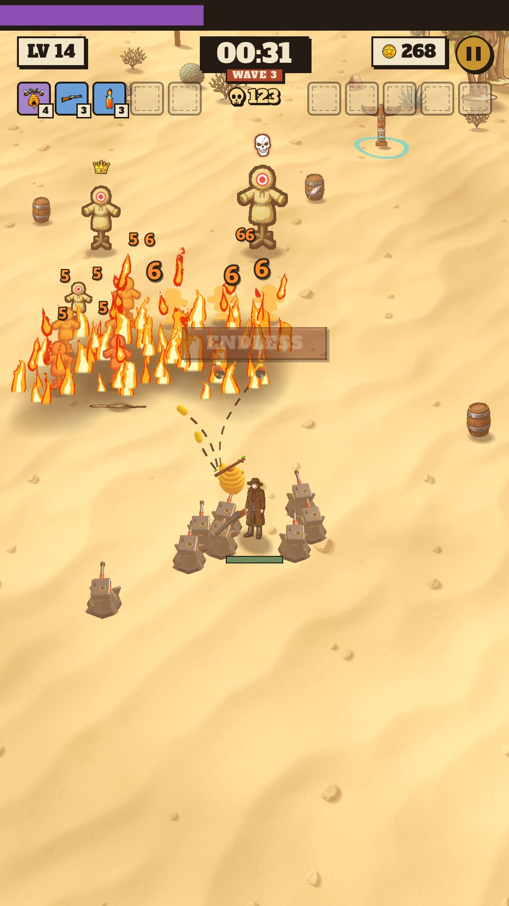

# 08 · In-run HUD

**When it shows:** the whole run.

**Its job:** Everything the player reads while playing, with nothing to tap below the strip except the floating joystick.

**On it now:**

- An XP rail across the top edge (purple fill on ink).
- A row of paper plates: 'LV n' left, the clock centred, the run's gold with a coin, the brass pause disc right. A tap anywhere on the strip pauses.
- The kill counter under the clock: a small skull and the count, with dings that grow with the kill rate (pass 109).
- The clock's modes: the stage's time on paper; while the portal waits, 'ENDLESS IN' and the seconds left on rock; in Endless the time survived on ink with 'WAVE n'.
- MUTATION NEXT: when a mutation offer is due the LV plate turns plum and 'MUTATION NEXT' sits at the rail's end.
- Ten slots: five weapons from the left, five Cards from the right; a held item is its plate in its level's colour with a level tag and a weapon's mutation dots (glowing when it can evolve); empty slots are dashed.
- Under them: power-up plates with seconds left (Sprint, Magnet, the War Drum's boost in drum red), build-up words (Adrenaline, Hot Streak ...) and the taken bounty's plate with its progress.
- A boss's name slab and HP bar while it lives; edge pointers (a paper tag with the target's name and distance) for an off-screen boss, Elite or the portal.
- Toasts under all that, one at a time; banners at 38% height (BOSS DOWN, EVOLVED · NAME, ENDLESS, PHOENIX FEATHER); '+N XP' and '+N' gold rising from the hero; the hero's HP and shield bars under him jiggle when hit (the screen does not shake); floating damage numbers (white, crits yellow, fire orange, poison purple; on the hero red, blue, green).

**Must still do (how is open):**

- Level and XP, time (and the portal and Endless states), kills, gold, pause.
- The build in ten slots with levels and mutation marks.
- Timed boosts, the bounty, the boss, pointers, messages.
- The thumb's area and the crowd around the hero stay clear.

**We suspect:**

- The strip carries a great deal; the plates under the slots grow downward into the play area in a long run.
- Passive items are not on the HUD at all.

**A question for you:**

- What would you drop from the strip first?
