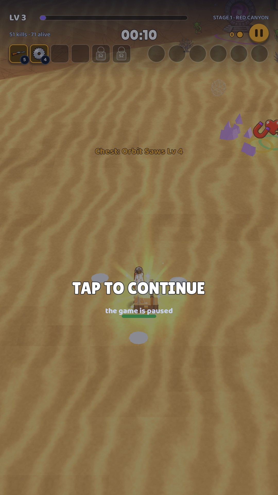

# 09 · Tap to continue

**When it shows:** after every pick and every chest.

**Its job:** Hold the pause until the player is ready, so a pick never drops them into a hit.

**On it now:**

- TAP TO CONTINUE and the game is paused over the dimmed world, with a toast of what was taken (Chest: Boomstick Lv 5).

**Must still do (how is open):**

- The gate: play resumes only on a tap, and the tap can start the joystick.

**We suspect:**

- It is one more screen state between the pick and the play.

**A question for you:**

- Could the chosen card fly to its slot on the strip while the gate waits?
