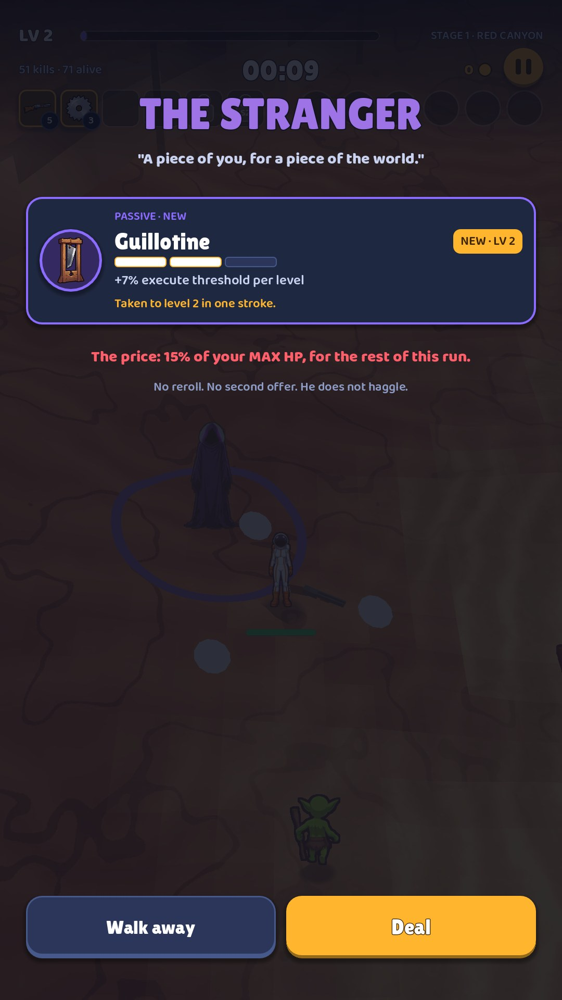

# 12 · The Stranger

**When it shows:** stepping into the hooded figure's ring on the map.

**Its job:** One strong item offered for a slice of max HP, for the rest of the run. Take it or walk away; he leaves either way.

**On it now:**

- THE STRANGER and a quote: A piece of you, for a piece of the world.
- One offer card with the item's icon, name, level and effect.
- The price: 15% of your MAX HP, for the rest of this run. and No reroll. No second offer. He does not haggle.
- Walk away, and Deal. The hooded figure stands on the map behind.

**Must still do (how is open):**

- The item, the price in max HP, deal or walk away.

**We suspect:**

- The Stranger is a speck in the background; the bargain has no drama.
- The price line competes with the item.
