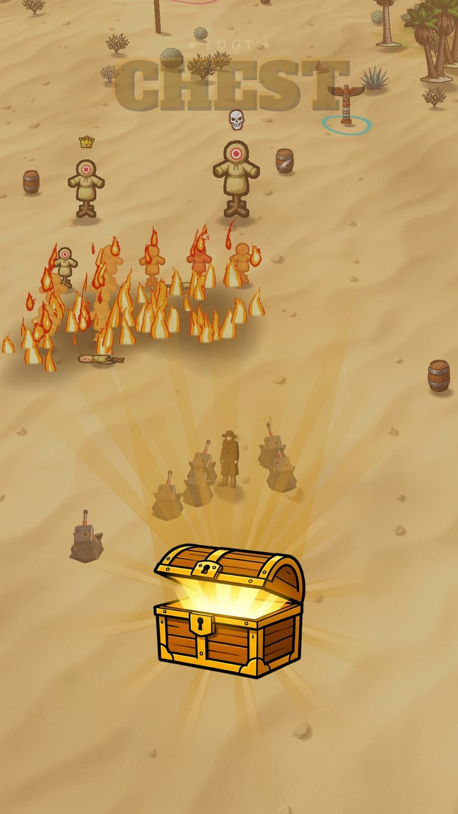
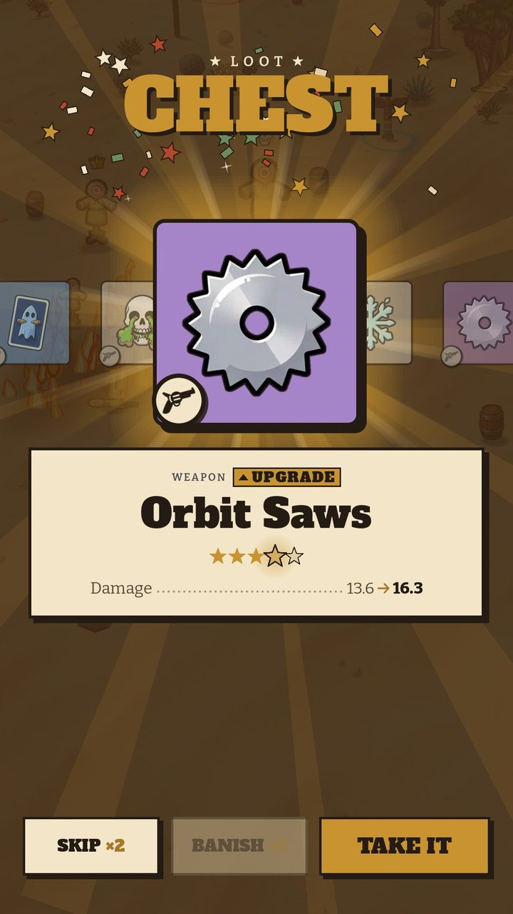
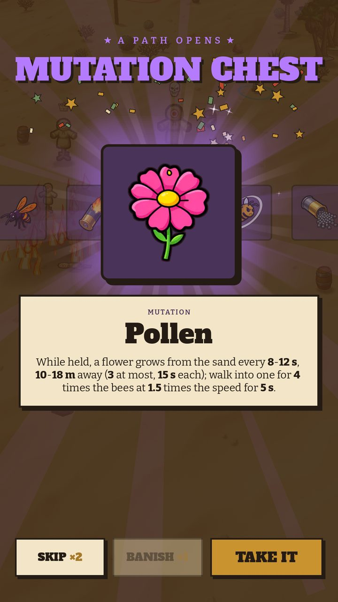

# 13 · Chest

**When it shows:** touching a chest (crowned Elites: the purple one; specials and the odd creature: the gold one).

**Its job:** The run's reward moment: a slot-machine reel lands on one item.

**On it now:**

- Star line 'Loot' and CHEST in brass (the purple chest's: 'A path opens', MUTATION CHEST in purple).
- The chest drops in, knocks three times and throws its lid open; its light rises into the reel's row; slot-machine sounds.
- The reel of plates runs for about four seconds and lands; the landed plate grows with a brass glow; under it the kind, tag, name, stars and effect (gold: 'Straight into the purse').
- SKIP ×N · BANISH ×N (the reel spins again) · TAKE IT. Taps hurry the opening and the spin. The purple chest also pulls every pickup on the map in. Since pass 118 the purple chest is the crowned Elites'; each boss drops its own chest (next page).

**Must still do (how is open):**

- A reward with a fanfare, what it is, take or pass.
