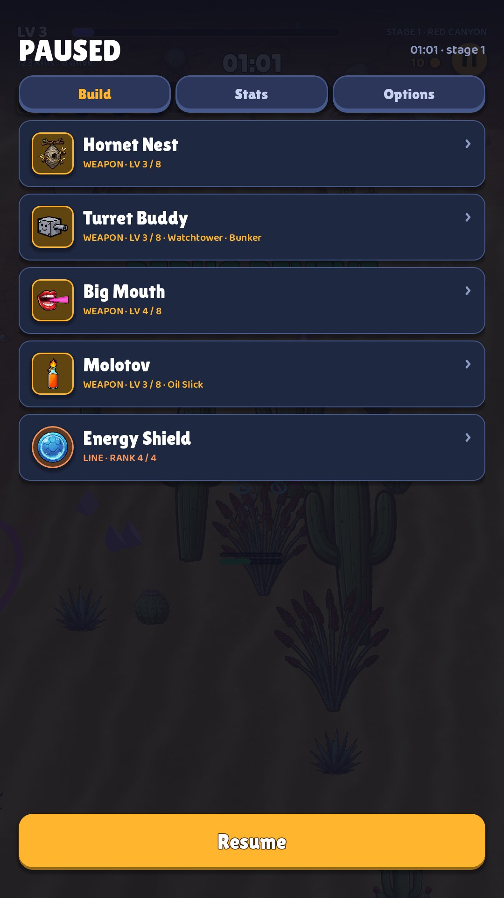
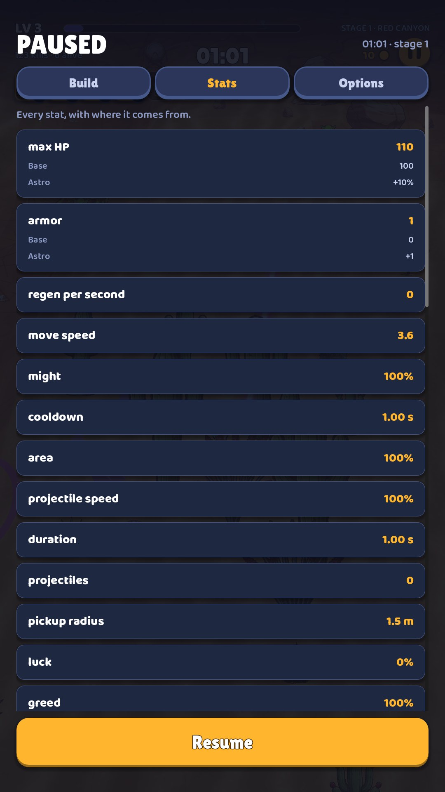
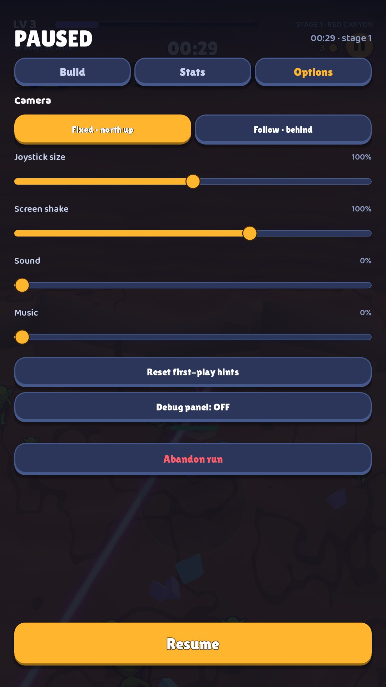

# 13 · Pause

**When it shows:** the pause button, or a tap on the top strip.

**Its job:** Stop the run; see the build and every number; change settings; give up.

**On it now:**

- PAUSED with the time and stage; tabs Build, Stats, Options; a big Resume at the bottom.
- Build: a row per held item (icon, name, WEAPON · LV 3 / 8 and its path picks such as Watchtower · Bunker); a tap opens the live numbers.
- Stats: every stat with where it comes from (max HP 110: Base 100, Astro +10%), more than twenty of them.
- Options: camera, joystick size, screen shake, sound, music, reset first-play hints, the debug panel, and Abandon run in red.

**Must still do (how is open):**

- Resume.
- The build with live numbers.
- The stats with their sources (for the players who want them).
- Sound, music, and abandoning the run.

**We suspect:**

- The Build rows do not say what each item does.
- Stats is a long table most players will never read.
- Options repeats Settings.
