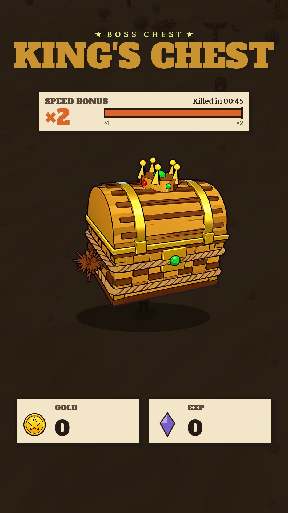
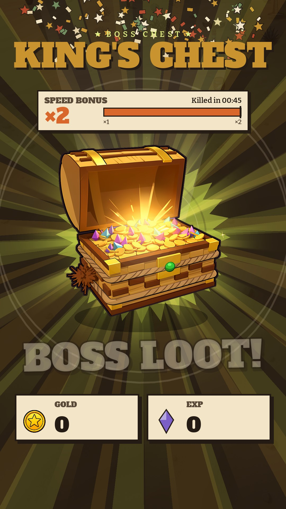
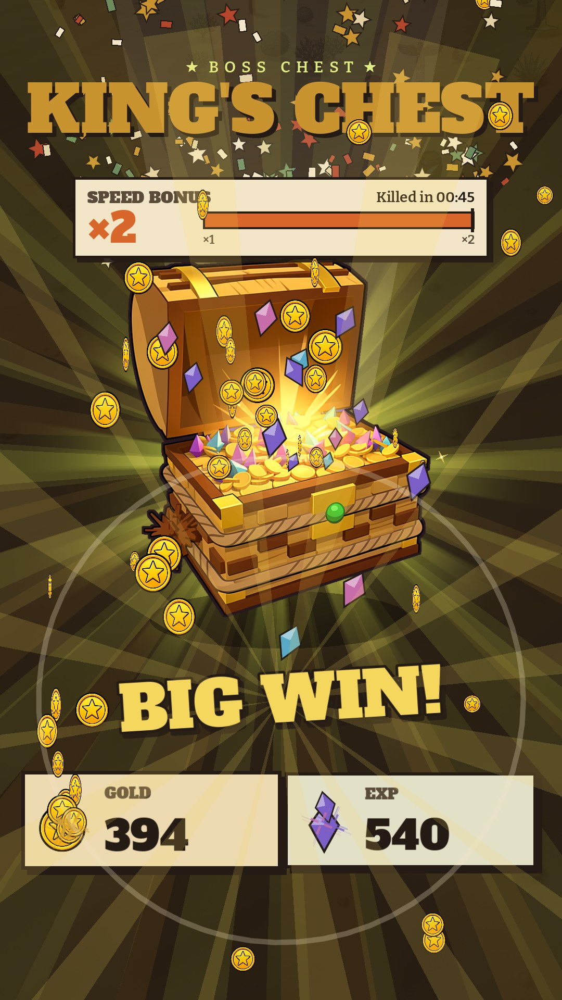
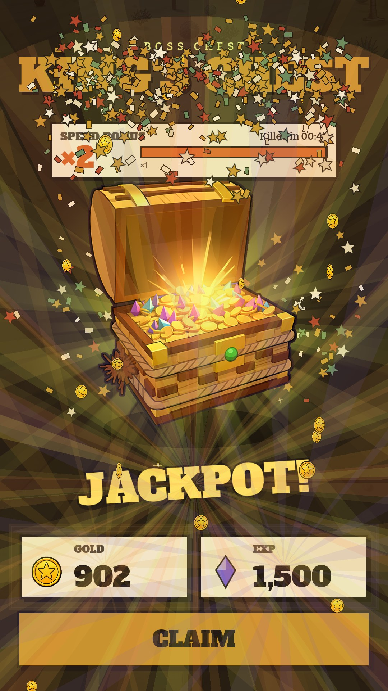
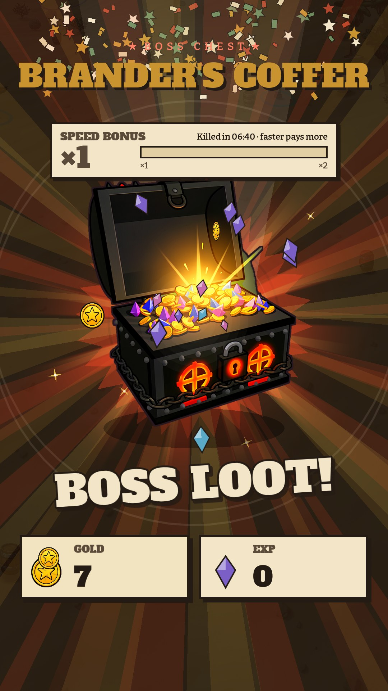
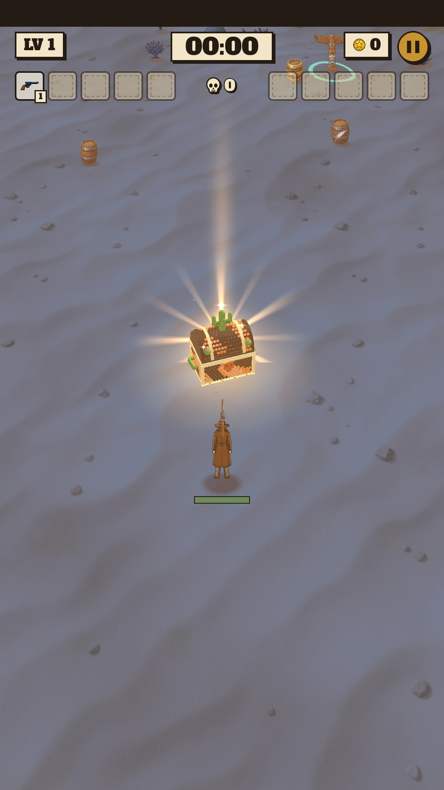

# 13b · Boss chest

**When it shows:** touching the chest a boss leaves (pass 118: each boss its own).

**Its job:** Pay out the boss's gold and XP as one big celebration, faster kills paying more.

**On it now:**

- Star line 'Boss chest' and the chest's name (KING'S CHEST, GILA'S HOARD, BRANDER'S COFFER) in brass.
- SPEED BONUS plate: the multiplier big (x1 to x2), 'Killed in m:ss' (at x1 '· faster pays more') and a gauge from x1 to the map's top with this kill's mark.
- The boss's own painted chest drops in, knocks four times harder each time, cracks on a line of light, then bursts open: a white flash, the screen shakes, rays in the boss's colour and gold, confetti, 'BOSS LOOT!'; a jackpot slot-machine tune starts.
- Coins and XP gems arc out of the chest into two counters at the bottom (GOLD with the coin, EXP with a gem), slowly at first, faster and faster; each counter bumps and sparkles as they land; the banner climbs BIG WIN!, HUGE WIN!, MEGA WIN!, coins rain down the screen; JACKPOT! when the last lands, bursts over both counters.
- CLAIM (one button) pays exactly the counters; back in the world the gold and gems burst out of the chest's spot and fly to the hero with everything else on the map. A tap before the burst skips to it; a tap during the spew hurries it.
- In the world each boss's chest is its own 3D model (straw, crown and rope; beaded gila scales and cacti; black iron, brands and chains) in its boss's light.

**Must still do (how is open):**

- The amounts in two big counters, the bonus for a fast kill said in plain numbers, one tap to claim.

**We suspect:**

- About 8 seconds at a stage's end; the tap that hurries it is not announced.

**A question for you:**

- Should the speed bonus also show the time to beat for the next tier?
