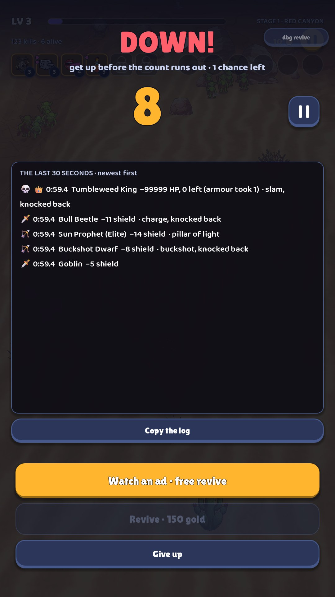

# 14 · Down! (revive)

**When it shows:** the hero's health reaches zero.

**Its job:** A second chance: revive before the count runs out, or give up.

**On it now:**

- DOWN! and get up before the count runs out · 1 chance left.
- A big count, 8, with a pause button beside it.
- THE LAST 30 SECONDS · newest first: a log of every hit (who, how much, what it did), with icons.
- Copy the log; Watch an ad · free revive (a stand-in: there are no ads yet); Revive · 150 gold (dimmed when short); Give up.
- A small dbg revive at the top right (developer only).

**Must still do (how is open):**

- The count.
- The ways to revive and their cost.
- Give up.
- What killed the hero (the full log is a test tool and can move to the developer menu).

**We suspect:**

- The log fills the screen, and the count sits off to one side.
- A dramatic moment with a flat tone.
