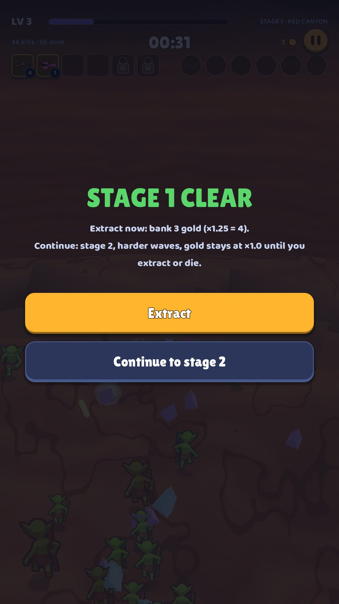

# 15 · Stage clear

**When it shows:** after each stage's boss, stepping into the portal.

**Its job:** The game's biggest decision: bank the gold now at ×1.25, or go on into a harder stage.

**On it now:**

- STAGE 1 CLEAR in green.
- Extract now: bank 0 gold (×1.25 = 0). Continue: stage 2, harder waves, gold stays at ×1.0 until you extract or die.
- Extract (gold) and Continue to stage 2.

**Must still do (how is open):**

- Both choices, with what each one means in gold.

**We suspect:**

- The core risk and reward of the game is told in two lines of small text instead of shown.
