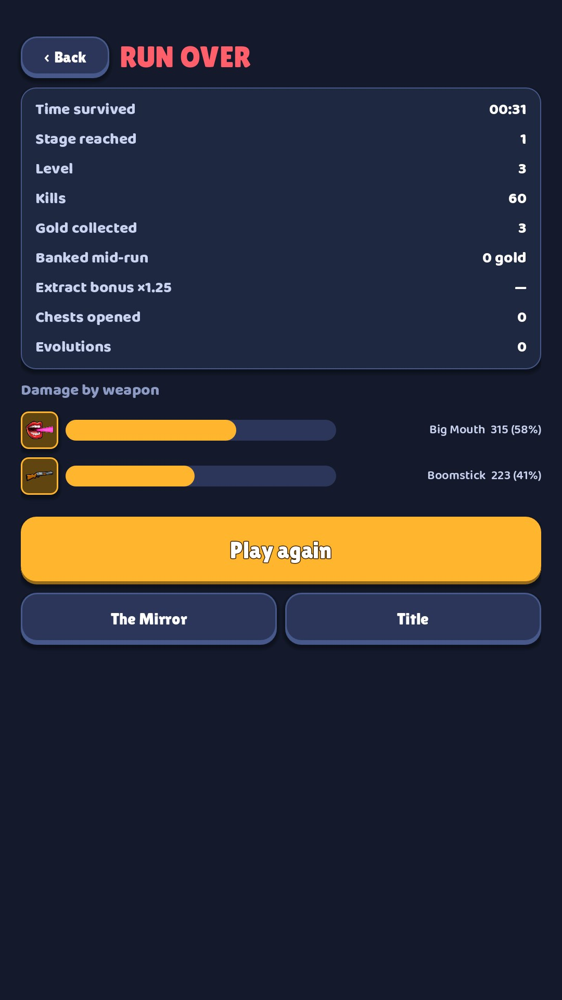

# 16 · Results

**When it shows:** after a run ends (death, giving up or extracting).

**Its job:** How the run went, what it earned, and the way into the next one.

**On it now:**

- RUN OVER (or a win title after extracting) with Back.
- A table: time survived, stage reached, level, kills, gold collected, banked mid-run, extract bonus, chests opened, evolutions.
- Damage by weapon: a bar per weapon with its icon and share.
- When gold was earned, a line that gold is kept, and any unlocks.
- Play again (gold), The Mirror, Title.

**Must still do (how is open):**

- Time, kills, level, gold earned, damage by weapon.
- Play again.

**We suspect:**

- It reads like a spreadsheet: no new best, no celebration, the hero is absent.
