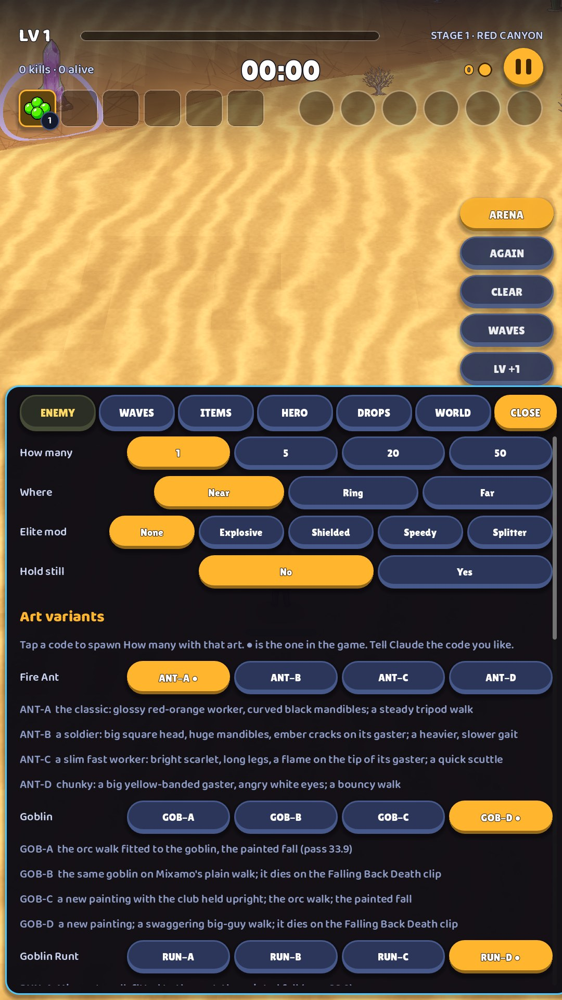

# 17 · Debug arena (developer only)

**When it shows:** only for us: Debug · Arena on the title.

**Its job:** A test room: the map and the hero with nothing coming unless we spawn it.

**On it now:**

- A column of quick buttons on the right: ARENA, AGAIN, CLEAR, WAVES, LV +1, and a status line.
- A bottom sheet with tabs ENEMY, WAVES, ITEMS, HERO, DROPS, WORLD: grids of tiles to spawn creatures, set the clock, hand over items.
- Art variants: chips that spawn a creature with a candidate art, to compare in play.

**Must still do (how is open):**

- All of it, for us.

**A question for you:**

- Low priority: no redesign needed. Flag anything from it that leaks into the player's screens, and suggest where one developer menu could live.
