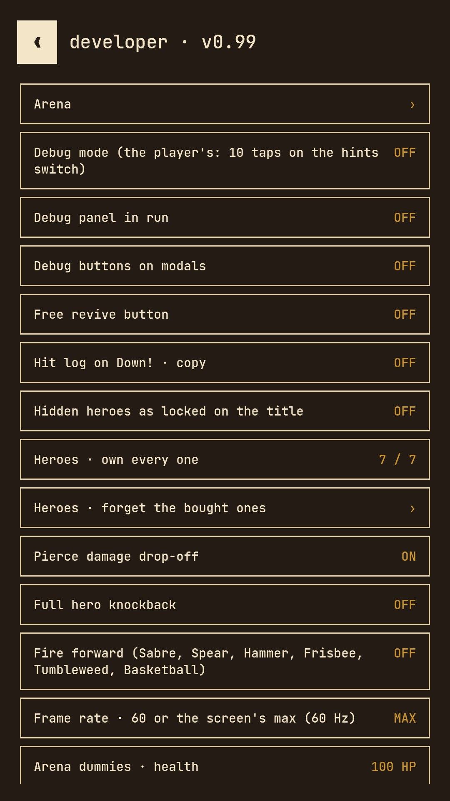
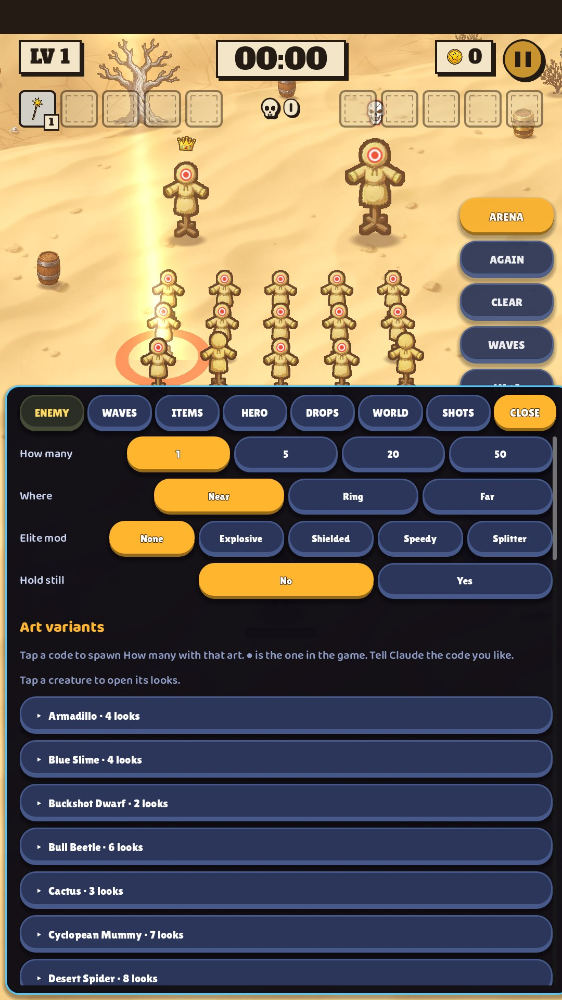

# 23 · Developer menu and debug arena (testers only)

**When it shows:** only for us: the developer menu (hold Settings' version line) and ARENA in debug mode.

**Its job:** Every test switch and readout in one ink list, and a test room for every creature, item, hero, look and drop. Not for players.

**On it now:**

- The developer menu: ink background, mono type; the arena, the debug switches, frame rate, the camera-cutout preview, analytics and survey tools, the save file's state.
- The arena: the map and the hero with nothing coming unless asked; a quick column on the right (ARENA, AGAIN, CLEAR, WAVES, LV +1) and a bottom sheet with ENEMY, WAVES, ITEMS, HERO, DROPS, WORLD and SHOTS tabs; the old UiKit look.
- Neither exists in the production build.

**Must still do (how is open):**

**A question for you:**

- Low priority: no redesign needed. Flag anything from it that leaks into the player's screens.
