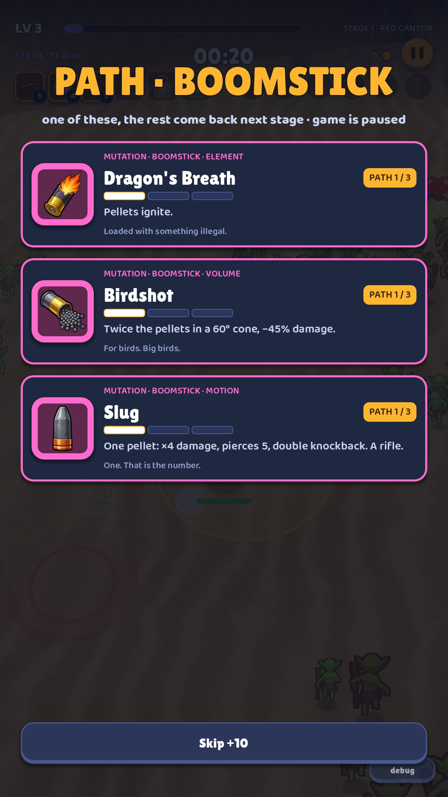
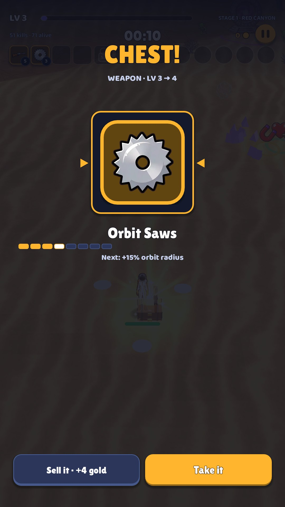
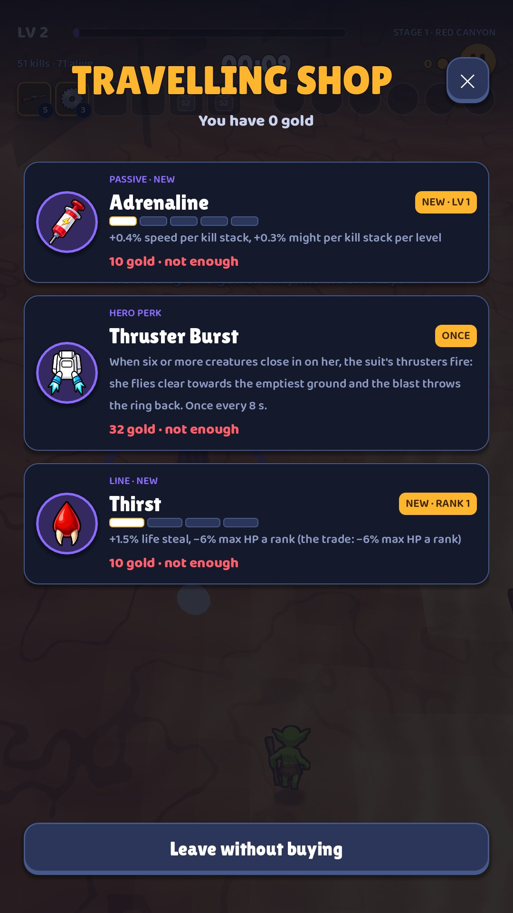

# 88fits UI redesign: the brief

**For:** Claude Design

**From:** the 88fits team (Garry, who designs and plays it, and Claude Code, who builds it)

**What is attached:** 17 screens and states in 25 screenshots at the game's real size, 1080×1920, one page per screen, and two pages of the game's painted art.

## What we are asking for

Redesign the UI of 88fits from the ground up. Today's UI is the thing under review: it is here to be judged and replaced, not to set the style.

- **Start from zero on the look.** Our colours, fonts, corner radii, borders, panels, icon frames and layouts are all open. Nothing in today's UI survives because it exists; keep a thing only if you would have chosen it yourself.
- **Critique first, and be tough.** Look at every screen the way a senior UI and art lead for mobile games would. Say what does not work and why, even if it is a whole screen.
- **Compare with the genre.** Put each screen next to how the best games in the genre handle the same moment (see "Compare it with the genre"), and say what they do better and what we should take.
- **Then design the alternative:** a new visual direction for the whole game, with every screen and every piece under "The pieces" redone in it, as mock-ups at 1080×1920.
- **Strip it down.** If an element, a line of text, a button or a screen does not earn its place, cut it, merge it or move it. Fewer, bigger, clearer things beat many small ones. You do not need our permission; tell us why.
- **Art counts as much as layout.** Backgrounds, framing, materials, colour, type, icon treatment and motion are all part of the redesign.

## The game in one minute

- 88fits is a portrait, one-thumb survivor shooter for Android phones, in the mould of Vampire Survivors, Megabonk and Survivor.io. The hero fires by himself; the player only steers, with a floating joystick, through a crowd that grows to 150 to 240 creatures.
- A run lasts up to 15 minutes: three stages of five minutes on one map, Red Canyon, a sunlit desert of sand, cacti and red rock. After each stage's boss the player chooses: extract (bank the run's gold at ×1.25) or continue into a harder stage.
- Every level-up pauses the run for a card pick: weapons, passives, lines (run-long traits with a trade-off), and hero perks. At set times a weapon's path (three mutations) is offered. Chests spin a one-item reel. On the map: a travelling shop, the Stranger (a strong item for a slice of max HP), healing wells, a strongbox that banks gold.
- Between runs: The Mirror (eight talents, two forms each, three ranks, paid in gold), the Collection, Settings.
- Art: anime-style painted heroes and creatures (cel shading, thick dark outline) standing as camera-facing cut-outs in a 3D desert. Item icons are in a Shop Titans style: one bold object, thick black outline, flat cel shading, painted at 256 px.
- Heroes today: Astro, a spacewoman in a white suit, and the Drifter, a cowboy in a long duster.
- Tone: short, dry, frontier humour. Names out of a western (the Drifter, the Stranger, High Noon, WANTED) and one-line jokes for flavour: "Pick one. Throw it at the rest." (the Gravity Gun), "Everything looks like a nail." (the Hammer).

## Who plays, and how

- One hand, portrait, short sessions, often on the move.
- In a run the thumb steers from anywhere in the lower two thirds of the screen: a floating joystick appears where it lands. So in-run information has to live where the thumb is not. Today that is a strip across the top 250 px, the hero's own bars and modal screens that pause the game; where it goes in your design is open, as long as the thumb's area and the crowd around the hero stay clear.
- Menus are tapped with the same thumb, so the lower half of the screen is the easy reach.
- Tested on a Pixel 8 Pro. The game draws a 1080×1920 canvas; taller phones get extra height, and the width stays 1080.

## Compare it with the genre

88fits is made in the mould of these games. For each screen, look at how they handle the same moment and say what to take, adapted to a portrait, one-thumb phone game rather than copied:

- **Vampire Survivors:** the original. A minimal HUD, a fast level-up list, a chest opening with a fanfare, a collection grid.
- **Survivor.io** and **Archero 2:** portrait, one thumb, built for phones. Chunky skill cards, levels shown as stars, big reward moments, polished menus between runs.
- **Megabonk:** the closest to our 3D camera. Upgrades coloured by rarity, chests, a character select.
- **Brotato:** the shop between waves, item rarity tiers, a stats panel people actually read.
- **20 Minutes Till Dawn** and **HoloCure:** leaner and cuter takes on the same loop.

## The pieces

Every piece below is in the screenshots, most of them on several screens. Redesign each once, show it in use, and show the states that matter (pressed, disabled, selected, locked, empty).

- **Buttons:** the main call to action (PLAY, GO, Resume, Take it), secondary buttons, small rows of buttons (Reroll, Skip, Banish), back, on/off switches and two-way choices.
- **The item card:** icon, name, what kind of item it is, its level now and after the pick, what it does (generated text, up to three lines), a flavour line. Used by level-ups, path offers, the chest, the shop and the Stranger.
- **Icon framing by kind:** weapon, evolution, mutation, passive, line, perk, hero, creature.
- **Level and progress marks:** an item's level out of its maximum, a weapon's path picks (up to three), a talent's ranks, and rarity: every item is common, rare or epic, which decides how often it is offered and what it costs, and today's UI never shows it.
- **List rows:** the collection and the pause screen's build list, open and closed, locked and unlocked.
- **Tabs, sliders and switches.**
- **Numbers:** gold (six digits and more, e.g. 102682), kills, the run clock, costs.
- **The in-run HUD:** level and XP, the run clock, the stage, kills, gold, pause, and the build: up to six weapons and six passives with their levels, path picks, and slots locked until a later stage.
- **Health and threats:** the hero's health and shield bars; a boss's name and health; pointers to an off-screen boss, Elite or portal.
- **Messages:** toasts (+22 HP, Boomstick Lv 5, HOOKED!), banners (BOSS DOWN, EVOLVED: Earthshaker), the +5 XP pop-ups, first-play hints.
- **The floating joystick.**
- **The modal frame:** every screen that pauses the run (level-up, path offer, chest, shop, the Stranger, stage clear, down) and the tap-to-continue gate.
- **The menu frame:** back, a title, a scrolling page.
- **One-offs:** the Mirror's talent cards, the hero and map cards in Play setup, the chest's reel, the results summary with its damage bars.

## Words the game uses

- **Weapon:** fires by itself, up to 8 levels. Four slots in stage 1, six from stage 2.
- **Passive:** a stat boost for the run, up to 5 levels.
- **Line:** a run-long trait of the hero, often with a trade-off, taken in ranks; three or four a run; a maxed line can evolve.
- **Perk:** a one-off power that only one hero is offered.
- **Path and mutation:** at set times a weapon offers its three mutations (an element, more of it, or a new motion). The player takes one; the others come back next stage.
- **Evolution:** a weapon with two mutations can turn into its evolved form at a chest.
- **Chest:** dropped by Elites, bosses and some creatures; a reel lands on one item to take or sell.
- **Elite and boss:** an Elite is a named, crowned creature stronger than the crowd; a boss ends each stage.
- **Portal and extract:** after a stage's boss a portal opens: extract (bank the run's gold at ×1.25) or continue into a harder stage.
- **The Mirror:** permanent talents bought with gold between runs.
- **The Stranger:** a hooded figure on the map who trades a strong item for a slice of max HP.
- **Travelling shop, healing well, strongbox:** stalls on the map to buy an item, heal, or bank gold mid-run.
- **Reroll, skip, banish:** redraw the level-up cards, pass for gold, or strike one card out of the run.

## The art it has to sit with

The painted art stays for now; the UI around it is what we want redone. The two art pages (right after this brief in the PDF; art_items.jpg and art_more.jpg in the pack) show every item icon, the heroes, the creatures and the badges that float over them; the screenshots show the world, a sunlit 3D desert of sand, cacti and red rock. Your UI frames this art. If you think the icons' style fights your direction, say so.

## What the UI must do (how is open)

- Portrait 1080×1920, one thumb.
- The game pauses behind every screen that asks for a choice, and play resumes only on a tap, so a pick never drops the player straight into a hit. How that gate looks is up to you.
- Every item's icon, name and generated numbers can be found somewhere.
- Each screen's "Must still do" list. How it looks, where it sits and whether it shares a screen with something else is open.

## What we can build

- Anything made of layered panels, images, text, bars and simple shapes, animated with tweens. Nine-slice frames and painted art are fine: our art pipeline paints backgrounds, frames, badges and icons in any style you define, and Blender can model small 3D pieces.
- Gradients, glows and animated effects through shaders are fine. A full-screen blur over the running 3D world is too costly on phones.
- Any open font (TTF) and new sounds.
- Card text is generated from the game's data, so its length varies: names up to about 20 characters, descriptions up to three lines. A design has to survive that.

## Today's UI, for reference only

So you know what you are looking at. None of it has to stay.

- Built in code in Godot 4.7 from a small kit: panels and cards with rounded corners (18 to 30 px) and 2 to 4 px borders, bevelled buttons, chips, icon tiles framed in their kind's colour, progress bars, level pips, sliders, tabs and scrolling lists.
- Colour: navy grounds with lighter navy lines, white and grey-blue text, gold for the main button and the selected state, violet for XP, red for danger, green for good. Cards are coloured by kind: weapons gold, passives violet, mutations magenta, lines orange, perks green.
- Type: Lilita One for headings and buttons, Baloo 2 for body text.

## The screens

| # | Screen | When the player sees it | Shots |
|---|---|---|---|
| 01 | Title | on launch, and after every run | 1 |
| 02 | Play setup | from the title's hero chip | 1 |
| 03 | The Mirror | between runs, from the title and from the results | 2 |
| 04 | Collection | between runs, from the title | 2 |
| 05 | Settings | from the title | 2 |
| 06 | In-run HUD | the whole run | 3 |
| 07 | Level-up cards | every level-up (every 20 to 40 seconds early in a run) | 2 |
| 08 | Path offer | at set times in each stage, once per weapon | 1 |
| 09 | Tap to continue | after every pick and every chest | 1 |
| 10 | Chest | opening a chest (from creatures, bosses and Elites) | 1 |
| 11 | Travelling shop | stepping into the shop's ring on the map (once per shop) | 1 |
| 12 | The Stranger | stepping into the hooded figure's ring on the map | 1 |
| 13 | Pause | the pause button, or a tap on the top strip | 3 |
| 14 | Down! (revive) | the hero's health reaches zero | 1 |
| 15 | Stage clear | after each stage's boss, stepping into the portal | 1 |
| 16 | Results | after a run ends (death, giving up or extracting) | 1 |
| 17 | Debug arena (developer only) | only for us: Debug · Arena on the title | 1 |

## What to send back

1. **The critique:** the ten biggest problems across the whole UI, most important first, one line each with why. Then, per screen, a verdict (keep, rework, merge or cut) and how the genre's best handle the same moment.
2. **Three visual directions**, clearly different from each other and from today's UI. Each one as a style tile (palette, type, shapes and materials, icon framing, a button, an item card) applied to two screens: the level-up cards and the in-run HUD. We pick one.
3. **Everything in the chosen direction:** every screen and every piece under "The pieces", mocked at 1080×1920 with their states.
4. **The flow:** which screens to merge, remove or reorder, and how a new player gets from launch to the first run.
5. **Notes for the build:** sizes in px on the 1080×1920 canvas, colours in hex, fonts, and which pieces repeat, so we build each once.

## What we already suspect

These are our own doubts. Confirm them, overrule them, and don't stop at them.

- The menus look like a generic dark app. Nothing in them says sunlit desert, anime, cowboys and a spacewoman: the painted art mostly stays inside the run.
- There is too much small text. A level-up card carries a kind tag, a name, a level chip, pips, a stat line and a flavour line. The Mirror and Play setup read like forms.
- Developer tools show on player screens: "Debug · Arena" on the title; "Last run's last second", "Recent system pauses" and the save file's path in Settings; "Debug panel" in the pause options; a small "debug" button on the level-up screen; a "dbg revive" on the Down! screen. They should move to one hidden developer menu.
- The in-run top strip is crowded: level, XP bar, stage and map, kills and alive count, the timer, gold, the pause button, six weapon slots and six passive slots with level badges and stage locks.
- Players meet Lines, Paths, Mutations, Evolutions and Perks. That may be too many named systems.
- The modal screens (level-up, path, chest, shop, the Stranger, stage clear) each look a little different. They could share one frame.
- The title's version label reads v0.4 (the game is at v0.27), and gold shows as a raw number (102682).

---

# The art it has to sit with

Every weapon, evolution, passive, line and hero perk in the game today, as the painted icons (256 px, transparent): one bold object, thick dark outline, flat cel shading. They stay; the frames, plates and cards around them are yours to design.

The weapons' path picks (mutations), the heroes' portraits, the creatures, Elites and bosses as the collection shows them, the badges that float over creatures in play (crown: Elite, skull: boss, gear: the specials), and the app icon.

---

# 01 · Title

**When it shows:** on launch, and after every run.

**Its job:** Start a run in one tap with the last hero and map, and reach everything else.

**On it now:**

- Top left: total gold (a gold bar and 102682) and the best run (best 10:00 · L14).
- The 88fits wordmark in gold on navy, and the line DRAG · DODGE · SURVIVE.
- The chosen hero's round portrait badge on a flat band of desert brown.
- PLAY, a big gold button.
- A chip naming the hero and map: Drifter · Red Canyon · change ▸ (opens Play setup).
- Three buttons: The Mirror, Collection, Settings.
- Debug · Arena (a developer test room) and the version label, v0.4.

**Must still do (how is open):**

- One tap to play with the last hero and map.
- A way to change hero and map.
- The Mirror, the Collection and Settings.
- Total gold.

**We suspect:**

- The lower half is flat bands of colour with a small badge; there is no sense of place.
- The version label is wrong (v0.4) and Debug · Arena is open to players.
- Gold is an unformatted number; the best-run chip is cryptic (L14 = level 14).

**A question for you:**

- Could the title carry the hero full-body in the desert, and let the player swipe heroes here instead of opening Play setup?

---

# 02 · Play setup

**When it shows:** from the title's hero chip.

**Its job:** Choose a hero and a map, then go.

**On it now:**

- Back and the title Play.
- Character: a card per hero with a round portrait, the name, the hero's trait in capitals (SPACE SUIT: +1 armor and +10% max HP. Every level-up patches the suit for 8% of her HP.), the favourite weapon and a flavour line. The chosen hero has a gold border.
- Map: one card, Red Canyon, with its flavour line and the best run on it (Best: 10:00 · level 14 · stage 2).
- GO, a big gold button. The lower half of the screen is empty.
- Two heroes can be played today; three more exist and are hidden for now. A locked hero would show its unlock quest.

**Must still do (how is open):**

- Pick a hero, see what makes the hero different (the trait and the favourite weapon).
- Pick a map.
- Go.

**We suspect:**

- It reads like a settings form. The heroes are small badges beside a paragraph.
- Half the screen is empty. The screen may not need to exist on its own (see the title).

**A question for you:**

- How would you show two heroes that play differently (armour and healing against speed and pickup range) at a glance?

---

# 03 · The Mirror

**When it shows:** between runs, from the title and from the results.

**Its job:** Spend gold on permanent talents between runs.

**On it now:**

- Back, the title, and a line in gold: 106382 gold · 300 spent on the Mirror.
- Eight talent cards, one under another (Grit, Drive, Stride, Fortune, Choice, Nerve, Study, Spite). Each has the talent's name, three rank bars at the top right, a one-line subtitle (Thicker skin, or harder bones.), two form buttons with the chosen one in gold (Padding / Plate), the chosen form's effect (+10% max HP a rank.) and a button for the next rank (Rank 2 · 252 gold).
- Take it all back, at the bottom: empties the board and returns every coin.

**Must still do (how is open):**

- All eight talents, each with its two forms, its three ranks and the price of the next rank.
- Switching form is free and keeps the ranks; the refund returns everything.

**We suspect:**

- Eight near-identical tall cards; the thing that matters (what a talent does) is the smallest text.
- The rank bars read as a signal-strength icon.
- It has no identity. The idea comes from the Mirror of Night in Hades: a mirror, a face in it, a gold frame could carry the screen.

**A question for you:**

- Could the whole board fit on one screen without scrolling?

---

# 04 · Collection

**When it shows:** between runs, from the title.

**Its job:** Everything in the game in one book: what each thing does, and how to unlock what is locked.

**On it now:**

- One long list in sections: Weapons, Evolutions, Passives, Mutations (62 of them), Lines, Hero perks, Characters, Enemies.
- Each row: the icon in a frame, the name and the flavour line. A tap opens the row to show the generated description.
- Locked rows are dimmed and show their unlock quest; an unmet creature shows ??? and Not met yet.
- At the end, a separate part: Hidden · not in the game right now. Weapons, evolutions, mutations, creatures and heroes kept for later, marked HIDDEN in red (second screenshot).
- At the very bottom: N / M unlocks done · K kills all time.

**Must still do (how is open):**

- Every item with its icon, name and description.
- How to unlock what is locked.
- The hidden part, kept apart from the rest.

**We suspect:**

- It is one scroll of more than 150 rows, with no tabs, filters or counts.
- The rows show the flavour line, not what the item does.
- The mutations swamp the list.

**A question for you:**

- Tabs by kind, a grid of icons, per-weapon pages that hold the weapon's mutations and evolution?

---

# 05 · Settings

**When it shows:** from the title.

**Its job:** Camera, controls, sound, hints, and wiping the save.

**On it now:**

- Last run's last second: a line of debug output.
- Recent system pauses: six lines of debug output.
- Camera: Fixed · north up, or Follow · behind, with an explanation.
- Controls: an explanation of the joystick, then sliders for joystick size, screen shake, sound and music.
- First-play hints: ON, Show hints again next run, Debug panel: OFF.
- Wipe save (gold, unlocks, everything) in red, and the save file's path.

**Must still do (how is open):**

- Camera mode, joystick size, screen shake, sound, music, hints, wipe save.

**We suspect:**

- It opens on debug output.
- Toggles are drawn as buttons whose label holds the state.
- The slider labels and values are small.

---

# 06 · In-run HUD

**When it shows:** the whole run.

**Its job:** Show the run at a glance while the thumb steers: level, time, gold, the build, the boss, the hero's health.

**On it now:**

- The top strip (250 px): LV 3 and the XP bar with STAGE 1 · RED CANYON; 106 kills · 6 alive; the big timer 01:01; gold with a coin; the round gold pause button.
- Under that, six weapon slots (square icons with level badges; slots that open in a later stage show a padlock and S2) and six passive slots (round).
- When a boss is up: its name and a long red bar under the strip, and its name again over it in the world. When it is off screen, a red chevron at the edge with the distance (BOSS 44 m); the portal gets a green one, the Elite an orange one.
- Toasts in the middle of the screen: +22 HP, Deadeye Lv 1, HOOKED!, SUPPLY DROP.
- Under the hero, his health bar and a blue shield bar. The joystick ring appears wherever the thumb lands.
- The world: violet XP gems, gold coins, red danger marks on the ground.

**Must still do (how is open):**

- Level and XP, the timer, gold, pause, the build at a glance, the boss's health, the hero's health and shield.

**We suspect:**

- The strip carries more than twenty elements; the slots are small (about 60 px).
- Text drawn over the world loses contrast on bright sand.
- Toasts land in the middle of the action.

**A question for you:**

- What would you take out of the strip altogether?

---

# 07 · Level-up cards

**When it shows:** every level-up (every 20 to 40 seconds early in a run).

**Its job:** Pick one of three or four upgrades, quickly, with the run paused.

**On it now:**

- LEVEL 3! and pick one · game is paused.
- Three or four full-width cards. Each has the icon in a frame of its kind's colour; a kind tag (PASSIVE · NEW, WEAPON · UPGRADE, LINE · EVOLUTION OF ENERGY SHIELD); the name; a chip (NEW · LV 1, LV 3 → 4, EVOLVE); level pips; what it does (+25% pickup radius per level); and a flavour line.
- At the bottom: Reroll ×1, Skip +10 (skipping pays 10 gold), Banish ×1 (removes one card for the rest of the run). A small debug button (developer only).
- The second screenshot shows an evolved line card (Aegis) among ordinary ones.

**Must still do (how is open):**

- Three or four choices with icon, name, what it does and how far along it is.
- Reroll, skip (pays gold) and banish, with how many are left.

**We suspect:**

- Each card is text-heavy; the kind tags are jargon.
- The lower half is empty and the three bottom buttons look alike.

**A question for you:**

- How would you make the right pick obvious in under two seconds?

---

# 08 · Path offer

**When it shows:** at set times in each stage, once per weapon.

**Its job:** Choose one of a weapon's three mutations. The two not chosen come back next stage; a weapon with two mutations can evolve at a chest.

**On it now:**

- PATH · BOOMSTICK and one of these, the rest come back next stage · game is paused.
- Three magenta cards: MUTATION · BOOMSTICK · ELEMENT (or VOLUME, or MOTION), the name (Dragon's Breath), a PATH 1/3 chip, pips, the effect (Pellets ignite.) and a flavour line.
- Skip +10 and the debug button.

**Must still do (how is open):**

- The three mutations with icon, name and effect.
- Skip.

**We suspect:**

- PATH · BOOMSTICK does not explain itself, and it looks almost the same as a level-up.
- Element, volume and motion are our words, not the player's.

**A question for you:**

- Should this feel like a bigger moment than a level-up?

---

# 09 · Tap to continue

**When it shows:** after every pick and every chest.

**Its job:** Hold the pause until the player is ready, so a pick never drops them into a hit.

**On it now:**

- TAP TO CONTINUE and the game is paused over the dimmed world, with a toast of what was taken (Chest: Boomstick Lv 5).

**Must still do (how is open):**

- The gate: play resumes only on a tap, and the tap can start the joystick.

**We suspect:**

- It is one more screen state between the pick and the play.

**A question for you:**

- Could the chosen card fly to its slot on the strip while the gate waits?

---

# 10 · Chest

**When it shows:** opening a chest (from creatures, bosses and Elites).

**Its job:** The run's reward moment: a reel spins past the run's items for about four seconds and lands on one; take it or sell it.

**On it now:**

- CHEST! and WEAPON · LV 4 → 5.
- One reel: the item's icon large in a gold frame between two arrows.
- The name (Boomstick), level pips and the next step (Next: +2 projectiles).
- Sell it · +5 gold, and Take it. A tap during the spin hurries it.

**Must still do (how is open):**

- The spin, the item it lands on, take or sell.

**We suspect:**

- The best moment in a run looks like a form: a small reel, a busy world behind it, no build-up or payoff.

---

# 11 · Travelling shop

**When it shows:** stepping into the shop's ring on the map (once per shop).

**Its job:** Buy one of three items with the run's gold, or leave. Either way the stall is gone.

**On it now:**

- TRAVELLING SHOP, a close button, and You have 0 gold.
- Three item cards like the level-up's, each ending in a price line (10 gold · not enough in red when short).
- Leave without buying.

**Must still do (how is open):**

- Three items with price, what they do and whether the player can afford them.
- Leave.

**We suspect:**

- Three red not enough lines shout; the price is not a button.
- The player cannot see what they already hold.

---

# 12 · The Stranger

**When it shows:** stepping into the hooded figure's ring on the map.

**Its job:** One strong item offered for a slice of max HP, for the rest of the run. Take it or walk away; he leaves either way.

**On it now:**

- THE STRANGER and a quote: A piece of you, for a piece of the world.
- One offer card with the item's icon, name, level and effect.
- The price: 15% of your MAX HP, for the rest of this run. and No reroll. No second offer. He does not haggle.
- Walk away, and Deal. The hooded figure stands on the map behind.

**Must still do (how is open):**

- The item, the price in max HP, deal or walk away.

**We suspect:**

- The Stranger is a speck in the background; the bargain has no drama.
- The price line competes with the item.

---

# 13 · Pause

**When it shows:** the pause button, or a tap on the top strip.

**Its job:** Stop the run; see the build and every number; change settings; give up.

**On it now:**

- PAUSED with the time and stage; tabs Build, Stats, Options; a big Resume at the bottom.
- Build: a row per held item (icon, name, WEAPON · LV 3 / 8 and its path picks such as Watchtower · Bunker); a tap opens the live numbers.
- Stats: every stat with where it comes from (max HP 110: Base 100, Astro +10%), more than twenty of them.
- Options: camera, joystick size, screen shake, sound, music, reset first-play hints, the debug panel, and Abandon run in red.

**Must still do (how is open):**

- Resume.
- The build with live numbers.
- The stats with their sources (for the players who want them).
- Sound, music, and abandoning the run.

**We suspect:**

- The Build rows do not say what each item does.
- Stats is a long table most players will never read.
- Options repeats Settings.

---

# 14 · Down! (revive)

**When it shows:** the hero's health reaches zero.

**Its job:** A second chance: revive before the count runs out, or give up.

**On it now:**

- DOWN! and get up before the count runs out · 1 chance left.
- A big count, 8, with a pause button beside it.
- THE LAST 30 SECONDS · newest first: a log of every hit (who, how much, what it did), with icons.
- Copy the log; Watch an ad · free revive (a stand-in: there are no ads yet); Revive · 150 gold (dimmed when short); Give up.
- A small dbg revive at the top right (developer only).

**Must still do (how is open):**

- The count.
- The ways to revive and their cost.
- Give up.
- What killed the hero (the full log is a test tool and can move to the developer menu).

**We suspect:**

- The log fills the screen, and the count sits off to one side.
- A dramatic moment with a flat tone.

---

# 15 · Stage clear

**When it shows:** after each stage's boss, stepping into the portal.

**Its job:** The game's biggest decision: bank the gold now at ×1.25, or go on into a harder stage.

**On it now:**

- STAGE 1 CLEAR in green.
- Extract now: bank 0 gold (×1.25 = 0). Continue: stage 2, harder waves, gold stays at ×1.0 until you extract or die.
- Extract (gold) and Continue to stage 2.

**Must still do (how is open):**

- Both choices, with what each one means in gold.

**We suspect:**

- The core risk and reward of the game is told in two lines of small text instead of shown.

---

# 16 · Results

**When it shows:** after a run ends (death, giving up or extracting).

**Its job:** How the run went, what it earned, and the way into the next one.

**On it now:**

- RUN OVER (or a win title after extracting) with Back.
- A table: time survived, stage reached, level, kills, gold collected, banked mid-run, extract bonus, chests opened, evolutions.
- Damage by weapon: a bar per weapon with its icon and share.
- When gold was earned, a line that gold is kept, and any unlocks.
- Play again (gold), The Mirror, Title.

**Must still do (how is open):**

- Time, kills, level, gold earned, damage by weapon.
- Play again.

**We suspect:**

- It reads like a spreadsheet: no new best, no celebration, the hero is absent.

---

# 17 · Debug arena (developer only)

**When it shows:** only for us: Debug · Arena on the title.

**Its job:** A test room: the map and the hero with nothing coming unless we spawn it.

**On it now:**

- A column of quick buttons on the right: ARENA, AGAIN, CLEAR, WAVES, LV +1, and a status line.
- A bottom sheet with tabs ENEMY, WAVES, ITEMS, HERO, DROPS, WORLD: grids of tiles to spawn creatures, set the clock, hand over items.
- Art variants: chips that spawn a creature with a candidate art, to compare in play.

**Must still do (how is open):**

- All of it, for us.

**A question for you:**

- Low priority: no redesign needed. Flag anything from it that leaks into the player's screens, and suggest where one developer menu could live.
