# Outlaw Survivors (88fits) UI review: the brief

**For:** Claude Design

**From:** the 88fits team (Garry, who designs and plays it, and Claude Code, who builds it)

**What is attached:** {NSCREENS} screens and states in {NSHOTS} screenshots at the game's real size, 1080×1920, one page per screen, and two pages of the game's painted art. Captured from version 0.99 (pass 116, 2026-10-31).

## What we are asking for

Review the UI of Outlaw Survivors from the ground up. Today's UI is the thing under review: it is here to be judged, and replaced where it falls short, not to set the style.

- **The look is open.** Today's screens use one kit, the "Wanted" design (aged paper, ink outlines, brass, slab type). It went in at pass 39 after the first review. Keep what earns its place; nothing survives only because it exists.
- **Critique first, and be tough.** Look at every screen the way a senior UI and art lead for mobile games would. Say what does not work and why, even if it is a whole screen.
- **Compare with the genre.** Put each screen next to how the best games in the genre handle the same moment (see "Compare it with the genre"), and say what they do better and what we should take.
- **Then design the alternative** where one is needed: mock-ups at 1080×1920 for the screens and pieces you would change.
- **Strip it down.** If an element, a line of text, a button or a screen does not earn its place, cut it, merge it or move it. Fewer, bigger, clearer things beat many small ones. Tell us why.
- **Art counts as much as layout.** Backgrounds, framing, materials, colour, type, icon treatment and motion are all part of the review.

## The game in one minute

- Outlaw Survivors (the project and its files are called 88fits) is a portrait, one-thumb survivor shooter for Android phones (and a PC build), in the mould of Vampire Survivors, Megabonk and Survivor.io. The hero fires by himself; the player only steers, with a floating joystick, through a crowd of a few hundred creatures.
- One map, **Red Canyon**: a sunlit desert of sand, cacti, red rock, a dry river, oases and a sandstone fort wall. It has three **stages**, and each stage is its own run, chosen from the Stages menu: Sundown (about 7 minutes to the Tumbleweed King), Nightfall (10 minutes, a blue night, to the Gila Grande) and Blood Moon (13 minutes, a red hell, to the Brander). After a stage's boss a portal opens for 60 seconds: extract with the run's gold, or stay and fight **Endless** waves until you fall.
- At the start of a run the hero falls down a beam of light, then three **Wanted posters** float in: take one bounty (kill so many, use a weapon, open barrels...) and it pays coins at the end if done.
- Every level-up pauses the run for a pick of three cards (weapons, Cards, passive items, hero perks). At set times the next level-up is a **mutation offer** instead (a weapon's path). Chests spin a slot-machine reel. On the map: a travelling shop, the Stranger (a strong item for a slice of max HP), 10-12 Totem Poles (a small gift each), the War Drum (a 15-second boost), barrels with coins and power-ups.
- Between runs: the **Upgrade board** (eight talents, two forms each, six ranks, paid in gold), the **Collection**, **Settings**, and the heroes on the title: nine heroes, the Drifter free, the others bought with gold once their unlock quest is done; heroes have **skins** (looks) bought or earned.
- Art: anime-style painted heroes and creatures (cel shading, thick dark outline) standing as camera-facing cut-outs in a 3D desert. Item icons are in a Shop Titans style: one bold object, thick black outline, flat cel shading, painted at 256 px.
- Heroes: the Drifter (a cowboy, Revolver), Astro (a spacewoman, Gravity Gun), Calavera (a mariachi skeleton, Guitarra), Ironwood (Spear), Solenne (Sun Scepter), Fadeaway (a basketball player), Jeżyk (a bald blue Slav in a tracksuit, Frisbee), May (Tommy Gun) and Mira.
- Tone: short, dry, frontier humour. Names out of a western (the Drifter, the Stranger, WANTED, Stakes) and one-line jokes for flavour: "Pick one. The desert waits." (the level-up), "A piece of you, for a piece of the world." (the Stranger).

## Who plays, and how

- One hand, portrait, short sessions, often on the move.
- In a run the thumb steers from anywhere below the top strip: a floating joystick appears where it lands. So in-run information has to live where the thumb is not: today a strip across the top (XP rail, level, clock and kill counter, gold, pause, ten item slots, power-up plates), the hero's own bars, banners, toasts, and screens that pause the game.
- Menus are tapped with the same thumb, so the lower half of the screen is the easy reach.
- Tested on a Pixel 8 Pro. The game draws a 1080×1920 canvas; taller phones get extra height, and the width stays 1080. Every screen keeps clear of a camera cutout.

## Compare it with the genre

For each screen, look at how these games handle the same moment and say what to take, adapted to a portrait, one-thumb phone game rather than copied:

- **Vampire Survivors:** the original. A minimal HUD, a fast level-up list, a chest opening with a fanfare, a collection grid.
- **Survivor.io** and **Archero 2:** portrait, one thumb, built for phones. Chunky skill cards, levels shown as stars, big reward moments, polished menus between runs, stage select.
- **Megabonk:** the closest to our 3D camera. Upgrades coloured by rarity, chests, shrines, a character select.
- **Brotato:** the shop between waves, item rarity tiers, a stats panel people actually read.
- **20 Minutes Till Dawn** and **HoloCure:** leaner and cuter takes on the same loop; HoloCure's stamps and quests.

## The pieces

Every piece below is in the screenshots, most of them on several screens. Review each once, and the states that matter (pressed, disabled, selected, locked, empty).

- **Buttons:** the main call to action (PLAY, TAKE IT, DEAL, RESUME), secondary buttons, the REROLL · SKIP · BANISH row with its counts, the back square, switches, sliders and two-way choices.
- **The item card:** plate (kind by colour, a corner glyph), kind word, name, level stars, an UPGRADE / NEW / EVOLUTION tag, one effect line or "Damage 12 → 15" rows, the favourite's heart. Used by level-ups, mutation offers, the chest, the shop and the Stranger.
- **Plates by kind and level:** weapons, Cards (lines), passive items on a rarity ladder (common to legendary, then evolved), mutations, perks, creatures with danger badges (Elite crown, boss skull, special gear).
- **Marks:** level stars, a weapon's mutation rivets, a talent's six rank slots, progress bars on quests and posters, stamps (BEATEN, PAID, TAKEN, BANISHED, UNLOCKED).
- **Lists and grids:** the Collection's tiles and pages, the pause Build rows and Stats cells with their sources card.
- **Numbers:** gold (e.g. 102,682), kills, the run clock, costs and prices.
- **The in-run HUD:** see its page. **Health and threats:** the hero's HP and shield bars, a boss's name and HP, edge pointers to an off-screen boss, Elite or the portal.
- **Messages:** toasts, banners (BOSS DOWN, EVOLVED, ENDLESS, PHOENIX FEATHER), +XP / +gold pop-ups, floating damage numbers, first-play hints.
- **The modal frame:** every screen that pauses the run, the TAP TO GO gate after a pick, and the one "Hold on" question card for deeds that cannot be undone.
- **One-offs:** the hero carousel and plaque, the hero drawer, the hero's Wanted-poster sheet, the stage cards, the mirror's talent tiles, the chest's reel, the Spirit Pole, the floating Wanted posters, the drum moment, the Results' charts and count-ups.

## Words the game uses

- **Weapon:** fires by itself, 5 levels, 5 slots.
- **Card (a "line" in code):** a run-long trait named after a tarot card, 5 slots, 4 levels; a maxed Card can evolve ("<card> Risen").
- **Passive item:** a stat item, no slot cap, climbs a rarity ladder as it levels; not on the HUD (the pause Build tab lists them).
- **Perk:** a one-off power only one hero is offered.
- **Mutation:** each weapon has three paths; a mutation offer at set times gives one. All three plus level 5 = its **evolution** at a chest.
- **Chest:** dropped by Elites, specials and bosses; a reel lands on one item.
- **Elite, special and boss:** an Elite is a crowned, stronger creature; a special a rare glowing one with a sure chest; a boss ends each stage.
- **Portal, extract, Endless:** after the boss, 60 seconds to walk into the portal and extract; then Endless waves until death. Every end of a run banks the purse.
- **Bounty / Wanted poster:** an optional task taken at the start of a run, paid in coins at the end if done.
- **Totem Pole, the Stranger, the shop, the War Drum, barrels:** things on the map that pause for a choice or give a boost.
- **Upgrade board ("the Mirror" in code):** permanent talents bought with gold between runs; **Stakes** is the talent that makes runs harder for more XP and coins.
- **Reroll, skip, banish:** redraw the cards (per run), pass on an offer (per stage), strike an item out of the run (per stage).

## The art it has to sit with

The painted art stays; the UI around it is what we review. The two art pages (right after this brief in the PDF; art_items.jpg and art_more.jpg in the pack) show every item icon, the heroes, the creatures and the badges that float over them; the screenshots show the world. Your UI frames this art. If you think the icons' style fights your direction, say so.

## What the UI must do (how is open)

- Portrait 1080×1920, one thumb, clear of a camera cutout.
- The game pauses behind every screen that asks for a choice, and after a pick play resumes only on a tap, so a pick never drops the player straight into a hit.
- One paused screen at a time (death wins); whatever else is due waits its turn.
- Every item's icon, name and generated numbers can be found somewhere.
- Each screen's "Must still do" list. How it looks, where it sits and whether it shares a screen with something else is open.

## What we can build

- Anything made of layered panels, images, text, bars and simple shapes, animated with tweens. Nine-slice frames and painted art are fine: our art pipeline paints backgrounds, frames, badges and icons in any style you define, and Blender can model small 3D pieces.
- Gradients, glows and animated effects through shaders are fine. A full-screen blur over the running 3D world is too costly on phones.
- Any open font (TTF) and new sounds.
- Card text is generated from the game's data, so its length varies: names up to about 20 characters, descriptions up to three lines. A design has to survive that.

## Today's UI, for reference

So you know what you are looking at.

- The "Wanted" kit (ui/wanted/), built in code in Godot 4.7: hard-edged paper panels with ink borders and hard ink shadows, brass rivets and stars, slab-serif titles, nailed paper tags, stamps, item plates coloured by kind and level. Every screen is built from the same components.
- Colour: paper #f3e6c8, ink #241b14, brass #c9932f (the primary button, the coin), rock red #b4472b (danger, bosses), sage #6e8b5e (health, good), mutation plum, XP purple; dims are sepia.
- Type: Alfa Slab One for titles, numbers and buttons, Bitter (and its italic) for body text, JetBrains Mono only in the developer menu.
- The world behind the menus: the title stands the hero in the map itself (the "live" title).

## The screens

| # | Screen | When the player sees it | Shots |
|---|---|---|---|
| 01 | Title | on launch, and back from every hub screen and from Results | 3 |
| 02 | Hero drawer | the square left of the title's hero plaque | 1 |
| 03 | Hero sheet and looks | a tap on the title's hero plaque | 4 |
| 04 | Stages | PLAY on the title, once the map's first stage has been beaten | 2 |
| 05 | Upgrade board | the title's Upgrade button, or Results' Upgrade button | 3 |
| 06 | Collection | the title's Collection button | 4 |
| 07 | Settings | the title's Settings button | 2 |
| 08 | In-run HUD | the whole run | 6 |
| 09 | Wanted posters (the bounty) | the start of a run, right after the hero lands from the spawn beam | 3 |
| 10 | Level-up cards | every level-up | 2 |
| 11 | Mutation offer | at set times in each stage, in place of the next level-up's cards | 2 |
| 12 | Tap to go | after a level-up pick, a mutation pick or a chest | 1 |
| 13 | Chest | touching a chest (Elites, specials, bosses) | 3 |
| 14 | The shop | standing in the travelling shop's ring on the map (once a stall) | 1 |
| 15 | The Stranger | standing in the hooded figure's ring on the map | 1 |
| 16 | Spirit Pole (Totem gifts) | standing at one of the map's 10-12 Totem Poles | 1 |
| 17 | War Drum moment | using the War Drum on the map | 2 |
| 18 | Pause | a tap on the HUD's top strip or pause disc, or the app leaving the screen | 4 |
| 19 | Down! | the hero's health reaches zero | 1 |
| 20 | Stage clear (the portal) | walking into the portal after a stage's boss | 2 |
| 21 | Results | after any run ends (extract, staying down, abandoning, falling in Endless) | 4 |
| 22 | Play-data question and surveys | the first launch (over the title), and now and then after a run (over Results) | 2 |
| 23 | Developer menu and debug arena (testers only) | only for us: the developer menu (hold Settings' version line) and ARENA in debug mode | 2 |

## What to send back

1. **The critique:** the ten biggest problems across the whole UI, most important first, one line each with why. Then, per screen, a verdict (keep, rework, merge or cut) and how the genre's best handle the same moment.
2. **Directions:** where the Wanted kit should go next, or up to three alternatives if you think it should be replaced. Each as a style tile (palette, type, shapes and materials, icon framing, a button, an item card) applied to the level-up cards and the in-run HUD.
3. **The screens you would change**, mocked at 1080×1920 with their states.
4. **The flow:** which screens to merge, remove or reorder, and how a new player gets from launch to the first run and the first bounty.
5. **Notes for the build:** sizes in px on the 1080×1920 canvas, colours in hex, fonts, and which pieces repeat, so we build each once.

## What we already suspect

These are our own doubts. Confirm them, overrule them, and don't stop at them.

- There is a lot of small text: card effect lines, the hero plaque's numbers, the hero sheet, the Upgrade board's tiles, the pause Stats tab.
- The run start has stacked up: the beam, then the bounty posters, then the first-play hints, then the first level-up.
- Players meet many named systems: Cards, passive items, mutations, evolutions, perks, Totem gifts, bounties, the Stranger, the War Drum, power-ups, Stakes.
- The HUD top strip is full: XP rail, level, clock with the kill counter and Endless states, gold, pause, ten slots, power-up plates, the bounty plate and build-up words.
- The Results screen plays a long show (banked gold, the chart, damage sources, the bounty, unlocks): is the order right, and is it too long?
- Rarity is shown on passive items only; weapons and Cards show levels by colour. Does a player read that?

---

# The art it has to sit with

Every weapon, evolution, passive, line and hero perk in the game today, as the painted icons (256 px, transparent): one bold object, thick dark outline, flat cel shading. They stay; the frames, plates and cards around them are yours to design.

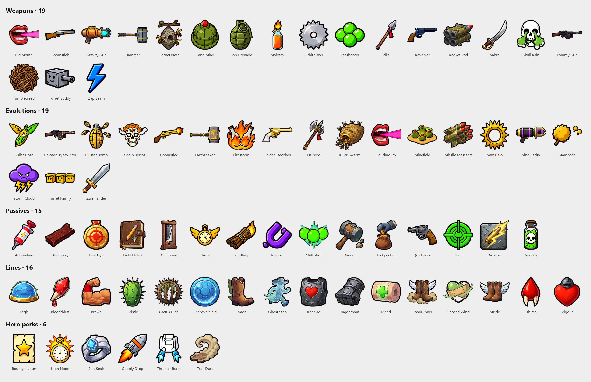

The weapons' path picks (mutations), the heroes' portraits, the creatures, Elites and bosses as the collection shows them, the badges that float over creatures in play (crown: Elite, skull: boss, gear: the specials), and the app icon.

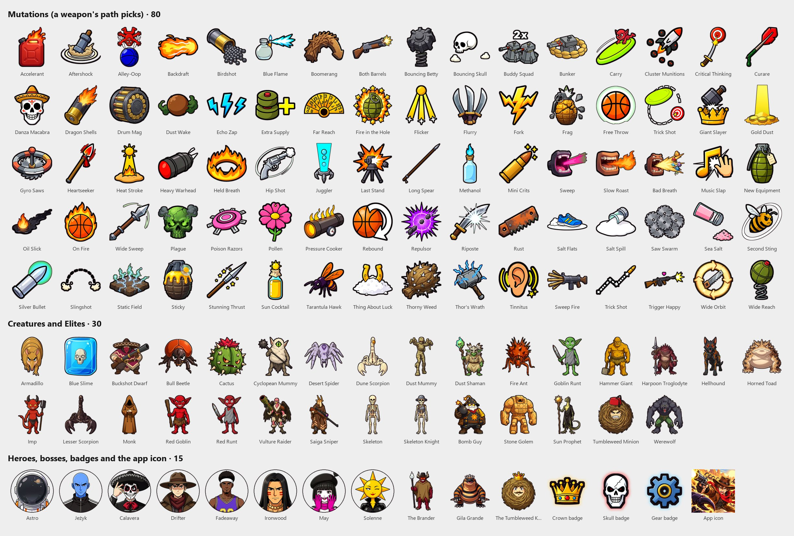

---

# 01 · Title

**When it shows:** on launch, and back from every hub screen and from Results.

**Its job:** Pick a hero and start a run in one tap; reach the Upgrade board, the Collection and Settings.

**On it now:**

- Top left the purse: a gold plate with a coin and the banked gold.
- The star line 'Wanted', the logo OUTLAW / SURVIVORS (the game's name on screen since pass 115) and 'Drag · Dodge · Survive'.
- The hero standing in the map itself, drawn as a run draws him, his start weapon's companion circling him; arrow squares either side and a swipe change hero (he runs in from the side the finger went); a dot per hero under him.
- The hero plaque: his name, a two-line flavour, up to three trait numbers (HP, SPEED, CRIT / LV ...), the START weapon and FAVOURITE item plates. A tap opens his Wanted-poster sheet; the square at its left opens the hero drawer.
- A hero on sale (his quest done, not bought): a BUY · <price> column over him; a tap asks 'Buy this hero?'.
- A locked hero: a black silhouette named 'Unknown', '?' for every number and plate, a padlock, and a 'To unlock' card with his quest and a progress bar; PLAY reads LOCKED.
- PLAY, the map line under it ('Red Canyon · best 7:10 · Lv 22 · stage 1 · 1,234 kills'), then Upgrade (turquoise, glowing, a brass '!' when a rank is affordable), Collection and Settings.
- Only in a tester's debug mode: ARENA top right. The first launch shows the play-data question over it (see its page).

**Must still do (how is open):**

- One tap to play with the last hero.
- Change hero, see who is locked and how to get him, buy one.
- Reach the Upgrade board, Collection and Settings.
- The purse.

**We suspect:**

- The plaque packs name, flavour, numbers and two plates into 200 px: hard to read at arm's length.
- Three ways to look at heroes (the carousel, the drawer, the sheet) may be one too many.

**A question for you:**

- Should the hero carousel and the hero drawer be one thing?

---

# 02 · Hero drawer

**When it shows:** the square left of the title's hero plaque.

**Its job:** See every hero at once and jump to one.

**On it now:**

- Every hero that is not hidden as a badge tile in two rows, each in the look he is played in, the shown one framed.
- A hero not owned: a black silhouette badge with '?' on an aged tile, his price with a coin under it (on sale) or 'Locked'.
- While it is open the square's glyph is a close X; the title's swipe is off (the drawer takes sideways drags); it scrolls when the heroes do not fit.

**Must still do (how is open):**

- Every hero, owned or not, in the carousel's order.
- Pick one in a tap.

**We suspect:**

- It covers the hero it is meant to choose.

---

# 03 · Hero sheet and looks

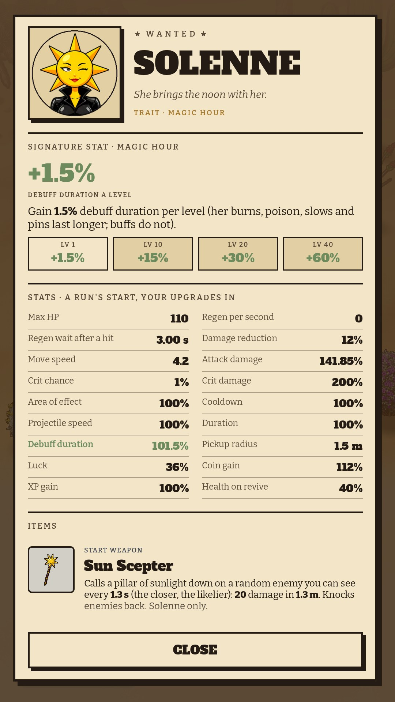
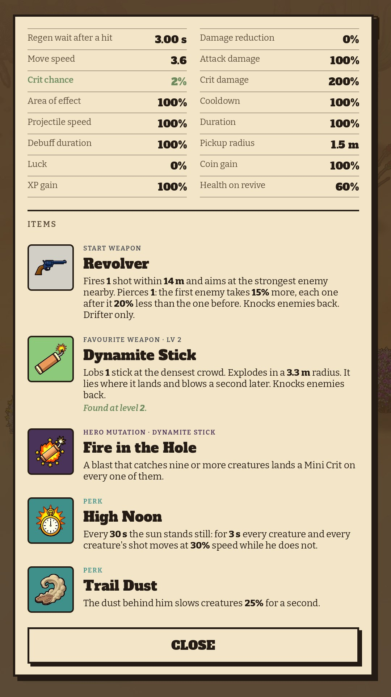
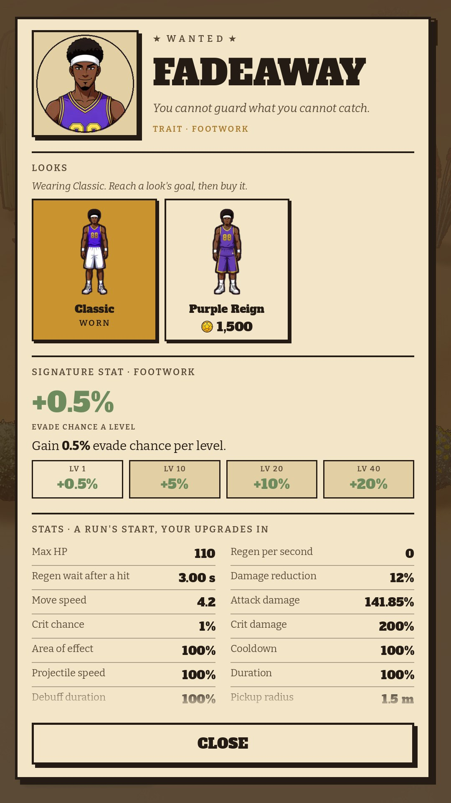
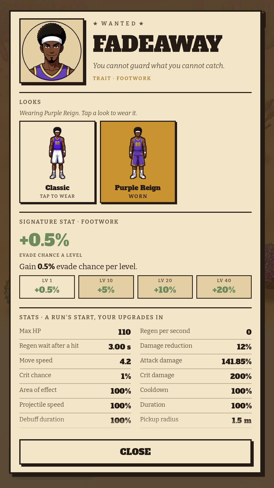

**When it shows:** a tap on the title's hero plaque.

**Its job:** The hero's CV as a Wanted poster: who he is, his signature stat, the stats a run starts with, his items, and his looks.

**On it now:**

- Portrait (the badge of the look he is played in), star line 'Wanted', the name, the slogan, 'Trait · <name>'.
- Signature stat: the trait's rule in words, its step per level in big numbers, and what it comes to at levels 1, 10, 20 and 40.
- 'Stats · a run's start' (and 'your upgrades in' when the Upgrade board has ranks): every stat a run starts with, his signature stats in sage, multipliers as percents (e.g. 'Health on revive').
- Items: the start weapon, the favourite and what finding it gives (a bonus level), weapons only he can find, his hero mutation, his perks; each with its plate and the level-up card's words.
- LOOKS: a row of skin tiles. Locked ones are dark silhouettes with their quest (e.g. beat a stage); others show a price and BUY (a 'Hold on' question first; short of gold is refused); owned ones can be worn, the worn one marked. The title then draws him in that look.
- A hero not owned: 'Unknown' under a black badge, '?' everywhere, 'Unknown until this hero is yours'; locked: a 'To unlock' box; on sale: 'On sale' with his price.
- CLOSE, a tap on the dim or the back gesture close it; a long sheet scrolls with a paper fade at its foot.

**Must still do (how is open):**

- Who the hero is and what makes him different, in numbers.
- His items.
- His looks: what each costs or needs, buy and wear.

**We suspect:**

- It is long: most players will read the top third only.
- Skins sit at the bottom of a stats sheet; is that where a player looks for them?

**A question for you:**

- Would the looks read better as their own screen or as a swipe on the title?

---

# 04 · Stages

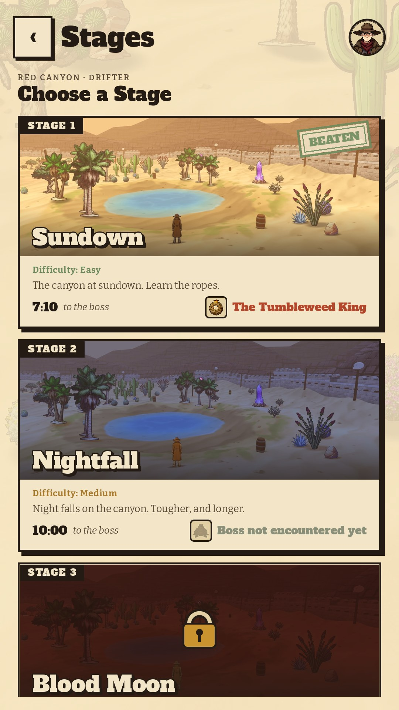
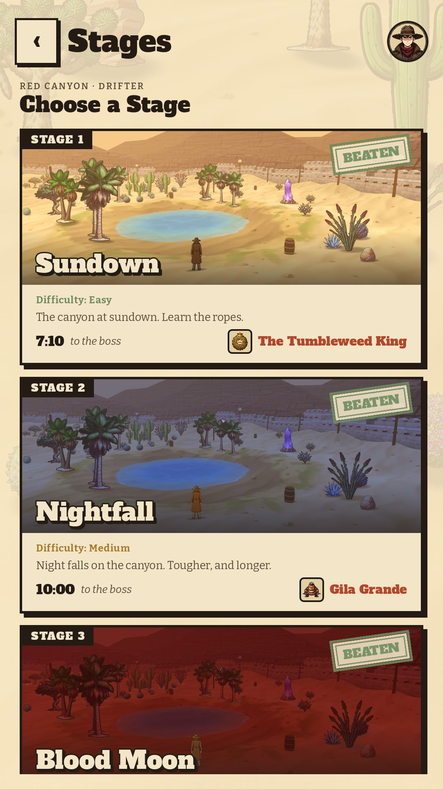

**When it shows:** PLAY on the title, once the map's first stage has been beaten.

**Its job:** Choose which stage of the map to play; each stage is its own fresh run with the chosen hero.

**On it now:**

- Header 'Stages' with the hero's badge; 'Red Canyon · <hero>' and the call 'Choose a Stage'.
- A card per stage (Sundown, Nightfall, Blood Moon): its picture with STAGE k and the name, 'Difficulty: Easy / Medium / Hard / Extremely Hard' in the stage's colour, a short description, the time to its boss and the boss.
- A sage BEATEN stamp on a beaten stage; a locked one aged with a padlock and 'To unlock: Beat the Tumbleweed King' (or 'Beat Stage k' before that boss was met); a boss never met is a silhouette, 'Boss not encountered yet'.
- A tap on an open card starts that stage at level 1; a locked card shakes.

**Must still do (how is open):**

- The three stages, what each asks, which are open and which beaten.
- Start one in a tap.

**We suspect:**

- Until stage 1 is beaten PLAY skips this screen, so a new player never learns the stages exist.

---

# 05 · Upgrade board

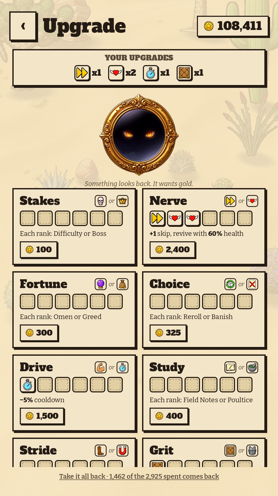
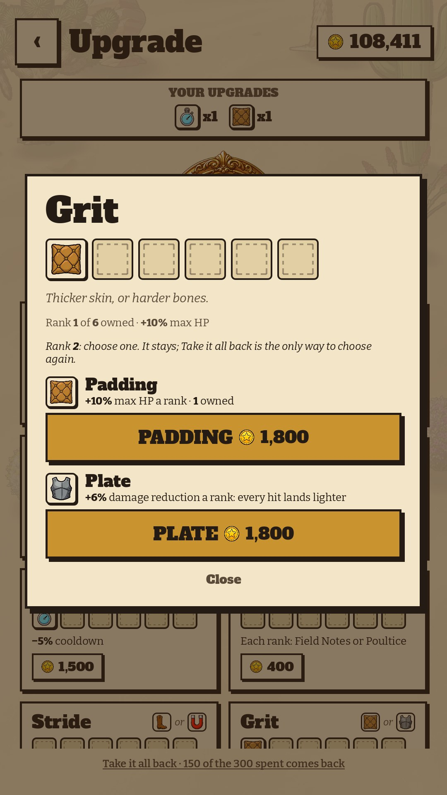
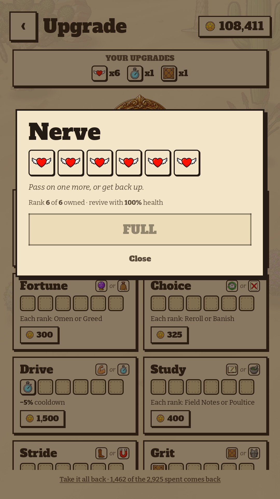

**When it shows:** the title's Upgrade button, or Results' Upgrade button.

**Its job:** The meta progression: spend banked gold on permanent talent ranks that hold for every hero.

**On it now:**

- Header 'Upgrade' with the purse; a YOUR UPGRADES strip with a chip per talent that has ranks (its form's icon and ×rank).
- The mirror (two brass eyes in dark glass) and 'Something looks back. It wants gold.'
- A two-column grid of eight talent tiles, sorted by first-rank price: Grit, Drive, Stride, Study, Fortune, Choice, Nerve, Stakes. Each: name, both forms' icons ('or'), six rank slots (bought ones show their form's icon), what a rank gives, the next price on a paper tag or 'Full'.
- A tile opens its sheet: the rank bar large, flavour, 'Rank r of 6 owned', and one buy button per form (e.g. PADDING · 120 / PLATE · 120). Every rank keeps the form it was bought in. Rank k costs k² × rank 1.
- Nerve: Skip (+1 skip a stage) or Second Wind (the health he gets up with: 40% at base, 100% at six ranks). Stakes: Difficulty or Boss: harder creatures (or bosses and Elites) for a hidden +5% XP and coins a rank.
- 'Take it all back' at the foot: a 'Hold on' question, then every rank goes and half the gold comes back.

**Must still do (how is open):**

- What each talent does, what is bought, what the next rank costs.
- Two forms per rank, fixed once bought.
- Undo all for half.

**We suspect:**

- Two forms per rank across six ranks is a lot of reading per talent.
- Stakes (pay to make it harder) needs its reward said plainly; today it is hidden.

---

# 06 · Collection

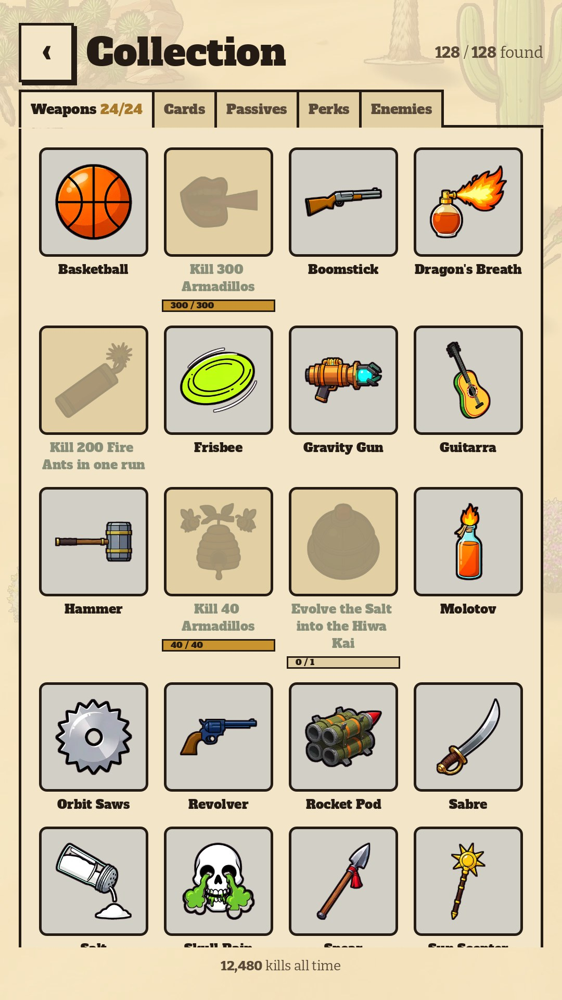
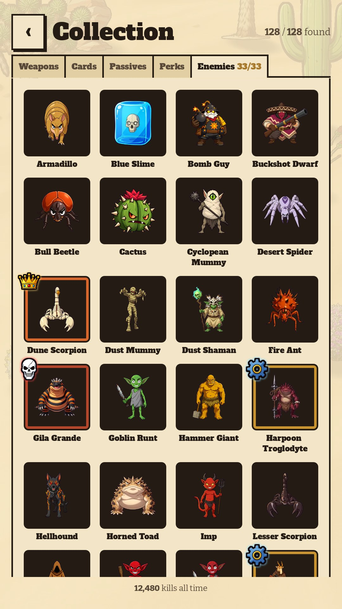
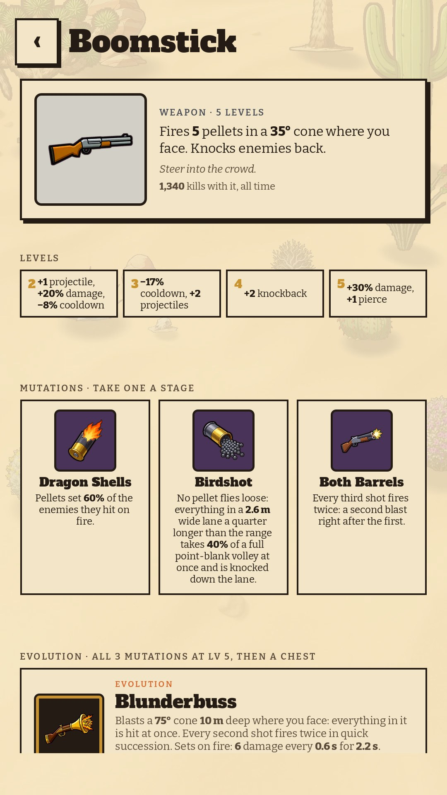
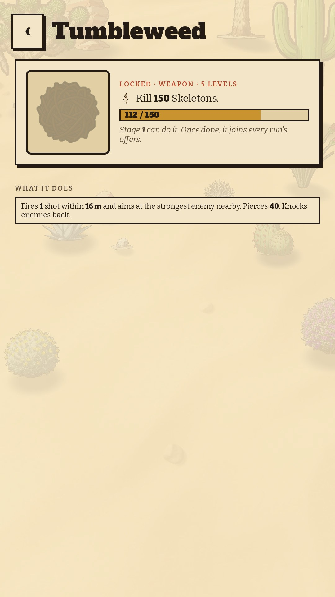

**When it shows:** the title's Collection button.

**Its job:** Browse every weapon, Card, passive item, perk and creature the player has met, and what locked ones need.

**On it now:**

- Tabs: Weapons, Cards, Passives, Perks, Enemies; the open tab's found count in the header ('n / m'); '<n> kills all time' at the foot.
- Tiles: the plate in its colour and the name; enemies carry danger badges (boss skull, Elite crown, special gear). Not found yet: an aged plate with the icon's shadow. Behind a quest: the quest's words and a brass progress bar.
- An item page: plate, kind line ('Weapon · 5 levels'), the full text, kills with it, a levels grid; a weapon lists its three mutations (heroes' own marked, e.g. 'CALAVERA ONLY') and its evolution; a creature its numbers and 'Killed n times'.
- A locked item's page: 'Locked · <kind>', the quest, its progress, which stage can do it.

**Must still do (how is open):**

- Everything met, its full numbers, and how to get what is locked.

**We suspect:**

- Five tabs of near-identical grids; the pages are walls of text.

---

# 07 · Settings

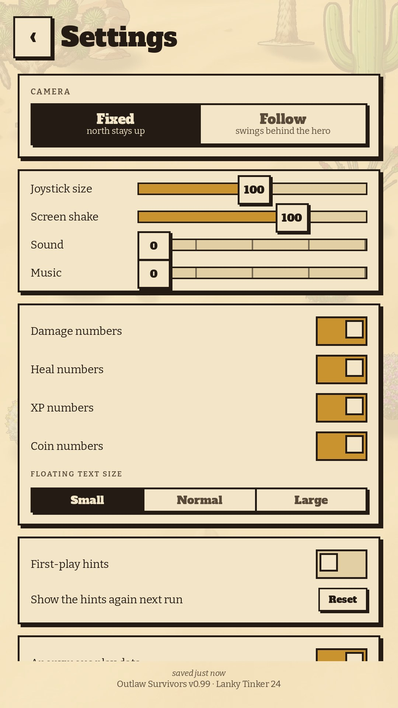
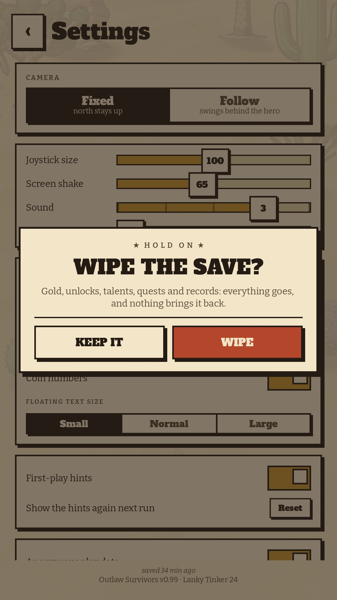

**When it shows:** the title's Settings button.

**Its job:** Player options, privacy switches and wiping the save.

**On it now:**

- Camera: Fixed ('north stays up') / Follow ('swings behind the hero').
- Sliders: joystick size 60-140%, screen shake 0-150%, sound and music.
- Switches for damage, heal, XP and coin numbers; floating text size Small / Normal / Large.
- First-play hints on/off and 'Show the hints again next run: Reset'.
- Anonymous play data and Questions after a run, each with a line on what it means.
- 'Wipe the save' (rock): a 'Hold on' question.
- The version line 'Outlaw Survivors v0.99 · <player name>' and when the save was last written. Holding it 2 s opens the developer menu; ten taps on the hints switch turn the tester's debug mode on (both absent in the production build).

**Must still do (how is open):**

- Every option above; each saves at once.

**We suspect:**

- Hidden doors (hold, ten taps) live on a player screen.

---

# 08 · In-run HUD

**When it shows:** the whole run.

**Its job:** Everything the player reads while playing, with nothing to tap below the strip except the floating joystick.

**On it now:**

- An XP rail across the top edge (purple fill on ink).
- A row of paper plates: 'LV n' left, the clock centred, the run's gold with a coin, the brass pause disc right. A tap anywhere on the strip pauses.
- The kill counter under the clock: a small skull and the count, with dings that grow with the kill rate (pass 109).
- The clock's modes: the stage's time on paper; while the portal waits, 'ENDLESS IN' and the seconds left on rock; in Endless the time survived on ink with 'WAVE n'.
- MUTATION NEXT: when a mutation offer is due the LV plate turns plum and 'MUTATION NEXT' sits at the rail's end.
- Ten slots: five weapons from the left, five Cards from the right; a held item is its plate in its level's colour with a level tag and a weapon's mutation dots (glowing when it can evolve); empty slots are dashed.
- Under them: power-up plates with seconds left (Sprint, Magnet, the War Drum's boost in drum red), build-up words (Adrenaline, Hot Streak ...) and the taken bounty's plate with its progress.
- A boss's name slab and HP bar while it lives; edge pointers (a paper tag with the target's name and distance) for an off-screen boss, Elite or the portal.
- Toasts under all that, one at a time; banners at 38% height (BOSS DOWN, EVOLVED · NAME, ENDLESS, PHOENIX FEATHER); '+N XP' and '+N' gold rising from the hero; the hero's HP and shield bars under him jiggle when hit (the screen does not shake); floating damage numbers (white, crits yellow, fire orange, poison purple; on the hero red, blue, green).

**Must still do (how is open):**

- Level and XP, time (and the portal and Endless states), kills, gold, pause.
- The build in ten slots with levels and mutation marks.
- Timed boosts, the bounty, the boss, pointers, messages.
- The thumb's area and the crowd around the hero stay clear.

**We suspect:**

- The strip carries a great deal; the plates under the slots grow downward into the play area in a long run.
- Passive items are not on the HUD at all.

**A question for you:**

- What would you drop from the strip first?

---

# 09 · Wanted posters (the bounty)

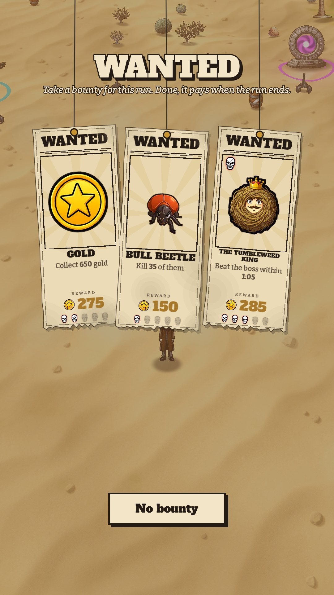
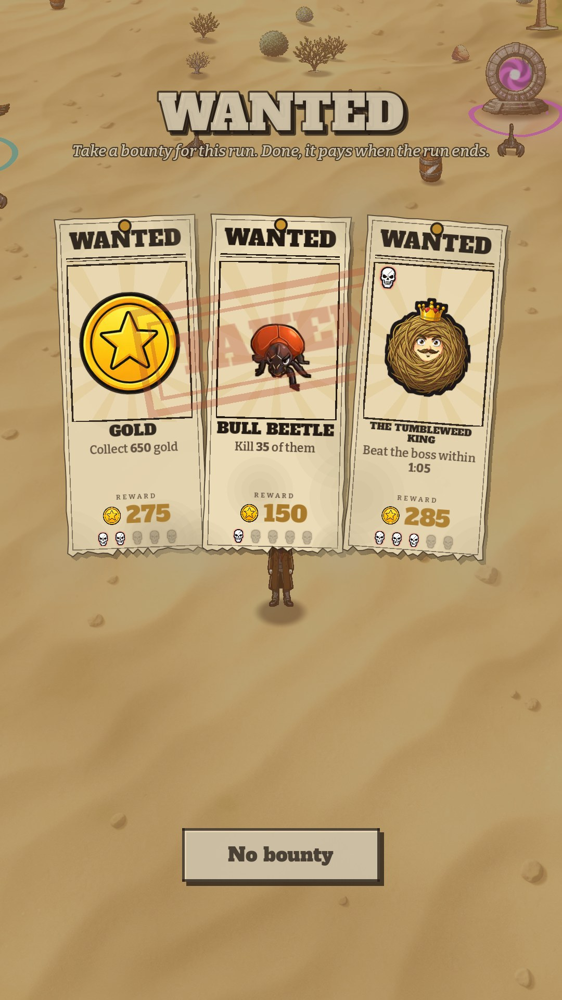
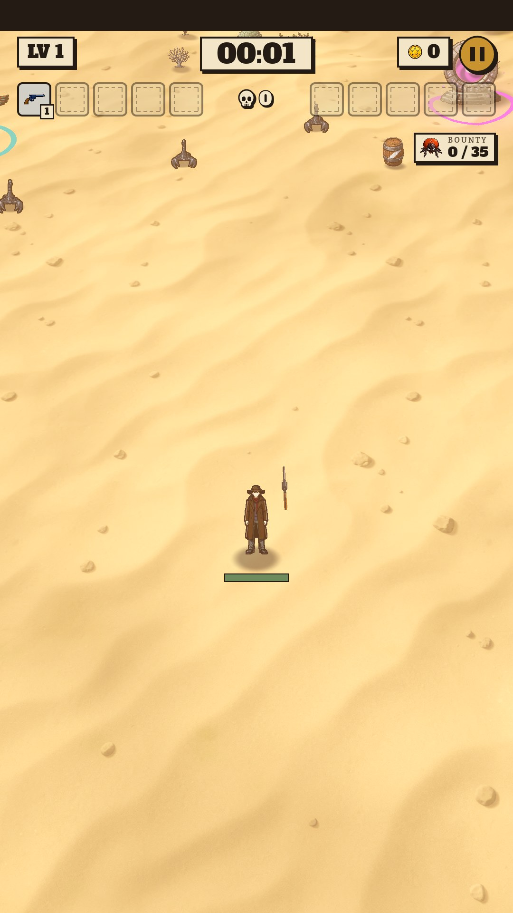

**When it shows:** the start of a run, right after the hero lands from the spawn beam.

**Its job:** Offer an optional task for this run, paid in coins at its end if done.

**On it now:**

- The run pauses under a light dim; three Wanted posters drop in on strings from the top and sway gently, each hung by its nail: the task (kill so many of a creature, deal damage with a weapon, open barrels, use totems, restore HP...), its target and its reward in coins.
- A tap on one takes it: stamped TAKEN, the others fall away, and it flies into a bounty plate on the right under the item row, which shows its progress for the run.
- 'No bounty' lets them all blow away.
- The reward is paid at the end of the run (Results shows it), only if the task was done.

**Must still do (how is open):**

- Three tasks, take one or none, see its progress during the run.

**We suspect:**

- It pauses the run a second time right after the beam; a new player has not yet seen a creature.

**A question for you:**

- Would the posters be better before the run, or as a plate that can be opened at will?

---

# 10 · Level-up cards

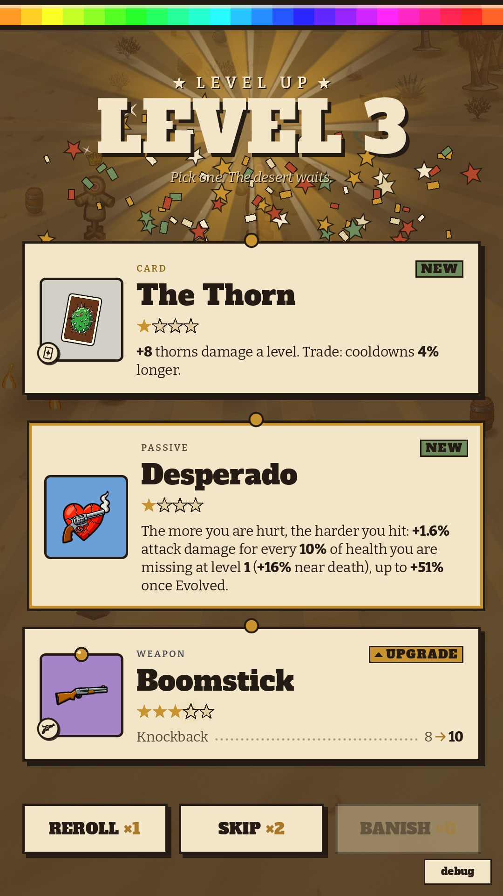
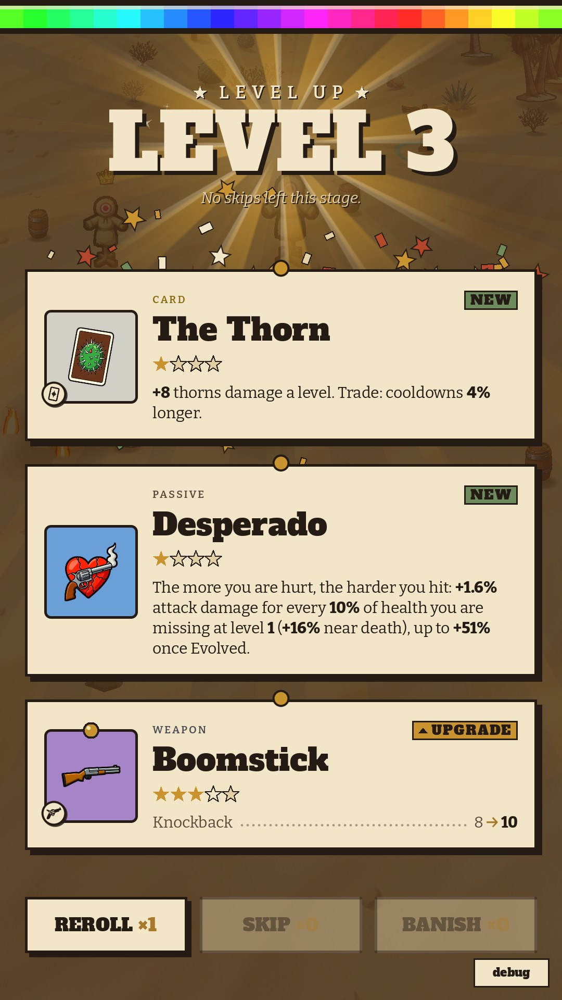

**When it shows:** every level-up.

**Its job:** Choose one of three upgrades: a new item or the next level of one held.

**On it now:**

- A full rainbow XP rail along the top; star line 'Level up', 'LEVEL N' over a turning brass shine, confetti on entry, the dry line 'Pick one. The desert waits.'
- Three item cards dropping in: plate, kind word, name, level stars, an UPGRADE (brass) / NEW (sage) / EVOLUTION (ember) tag, one effect line, or for an upgrade its changes ('Damage 12 → 15') with the new stars pulsing; the hero's favourite has a brass heart.
- REROLL ×N (per run) · SKIP ×N · BANISH ×N (per stage). Banish mode turns the title red and stamps what may go; refused cards shake and say why. At 0 a button locks and says what gives more.
- Levels gained during a pause are banked and shown one after another; with nothing left to offer, +10 gold.

**Must still do (how is open):**

- Three choices, readable in a glance.
- Reroll, skip, banish with their counts.

**We suspect:**

- The card's lower half (effect lines) is small for the most-read screen of the game.

---

# 11 · Mutation offer

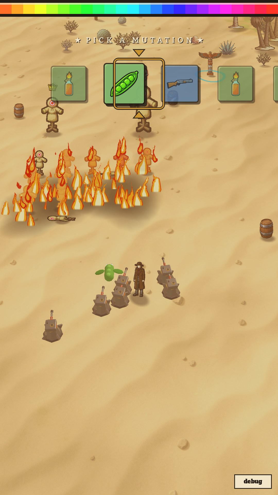
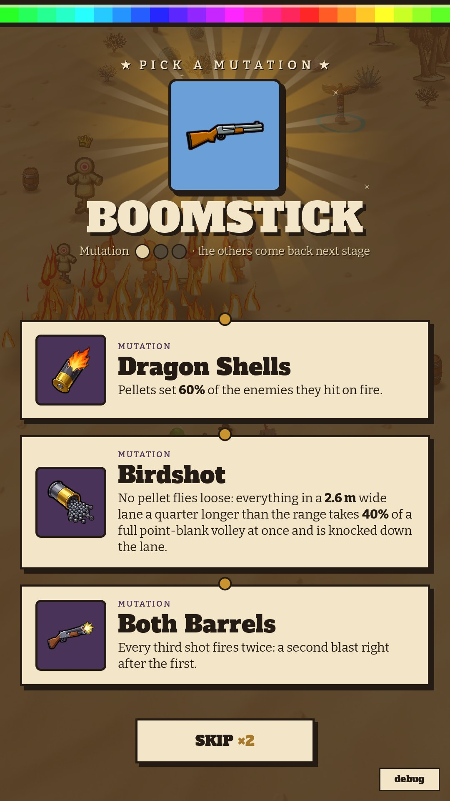

**When it shows:** at set times in each stage, in place of the next level-up's cards.

**Its job:** Take one of a weapon's path mutations; all three plus level 5 lead to its evolution.

**On it now:**

- First a reel: the hero's weapons with an open path slide past a brass window, ticking and slowing, and stop on one (a tap skips to the landing).
- Head: 'Level N! Pick a mutation', the weapon's plate with a shine, its name and its mutation rivets (taken / offered).
- The mutation cards under it; one SKIP ×N. No reroll or banish here.

**Must still do (how is open):**

- Which weapon, which mutations, how far along its path.

**We suspect:**

- The reel adds a wait to a pause the player did not ask for.

---

# 12 · Tap to go

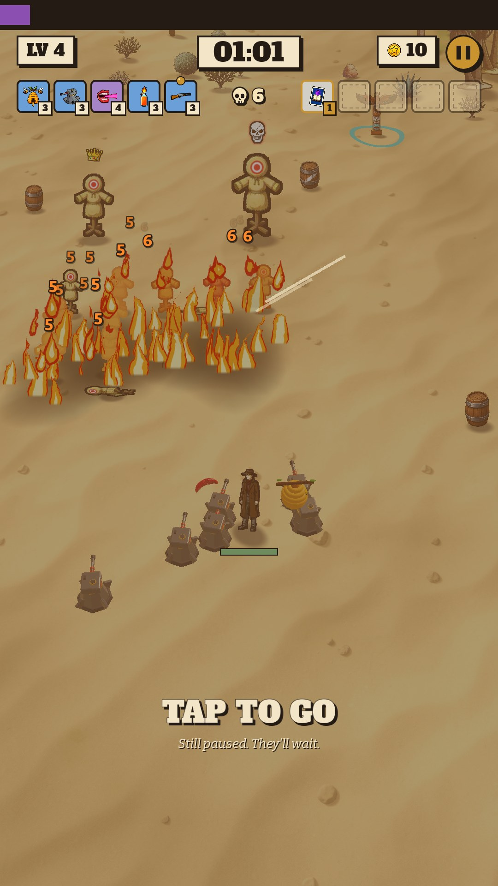

**When it shows:** after a level-up pick, a mutation pick or a chest.

**Its job:** Let the player re-grip before the run goes on, and show where the pick went.

**On it now:**

- The dim lifting to a light sepia; the picked card shrinking and flying into its HUD slot, which takes a brass border.
- 'TAP TO GO' and 'Still paused. They'll wait.' low on the screen; any touch resumes (with a second of blinking safety) and can start the joystick at once.

**Must still do (how is open):**

- No pick drops the player straight into a hit.

---

# 13 · Chest

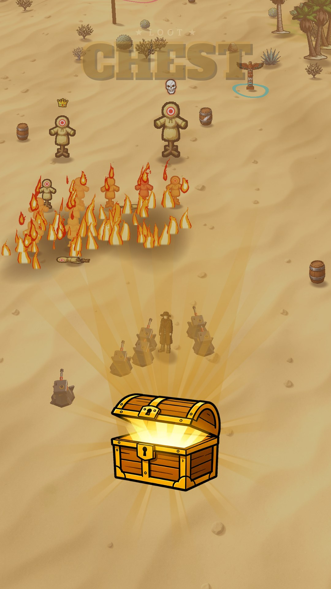
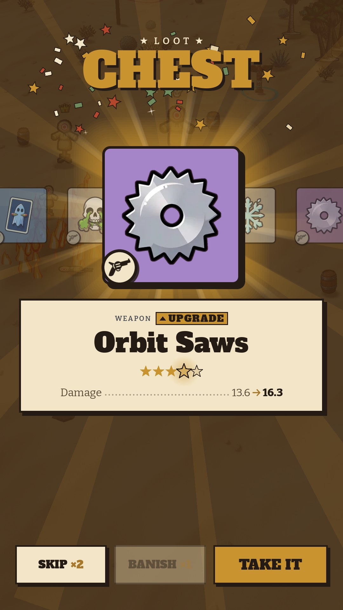
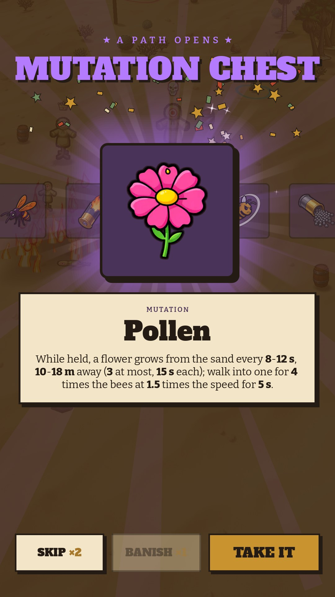

**When it shows:** touching a chest (Elites, specials, bosses).

**Its job:** The run's reward moment: a slot-machine reel lands on one item.

**On it now:**

- Star line 'Loot' and CHEST in brass (a boss's: 'A path opens', MUTATION CHEST in purple).
- The chest drops in, knocks three times and throws its lid open; its light rises into the reel's row; slot-machine sounds.
- The reel of plates runs for about four seconds and lands; the landed plate grows with a brass glow; under it the kind, tag, name, stars and effect (gold: 'Straight into the purse').
- SKIP ×N · BANISH ×N (the reel spins again) · TAKE IT. Taps hurry the opening and the spin. A boss chest also pulls every pickup on the map in.

**Must still do (how is open):**

- A reward with a fanfare, what it is, take or pass.

---

# 14 · The shop

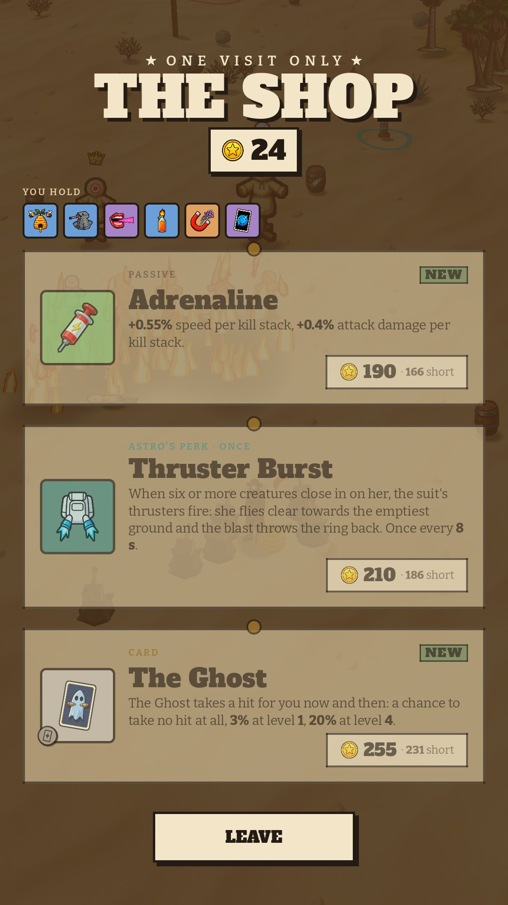

**When it shows:** standing in the travelling shop's ring on the map (once a stall).

**Its job:** Spend the run's gold on one of three items.

**On it now:**

- Star line 'One visit only', THE SHOP, the run's gold.
- 'You hold': a wrapping row of plates for everything held.
- Three item cards with their prices as buttons; one short of gold is aged with '· N short'. One purchase, or LEAVE; either way the stall is spent.

**Must still do (how is open):**

- What is for sale, what it costs, what the player holds.

---

# 15 · The Stranger

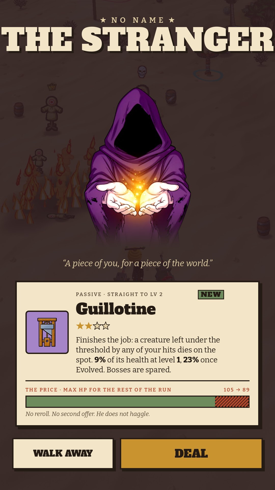

**When it shows:** standing in the hooded figure's ring on the map.

**Its job:** A bargain: one strong item for a share of max HP for the rest of the run.

**On it now:**

- A plum-black dim, star line 'No name', THE STRANGER; his cut-out holding the item and '“A piece of you, for a piece of the world.”'
- The item as a card; 'The price · max HP for the rest of the run' as a bar losing its end in hatched rock, 'max → new max'; 'No reroll. No second offer. He does not haggle.'
- DEAL or WALK AWAY; either way he is gone. His hooded figure is also the icon of what he gave in the pause Stats sources (pass 116).

**Must still do (how is open):**

- The item, the exact HP cost, yes or no.

---

# 16 · Spirit Pole (Totem gifts)

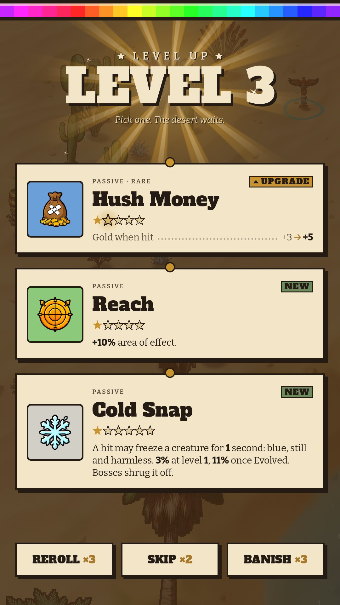

**When it shows:** standing at one of the map's 10-12 Totem Poles.

**Its job:** Pick one of three small stat gifts that last the whole run.

**On it now:**

- '★ TOTEM k OF n ★' over the paused world in the modal dim, the HUD hidden.
- A carved pole on the left: the thunderbird crest on top, three spirit segments with carved faces on a cedar post.
- A nailed paper tag beside each: the amount big with its stat ('+2%' 'move speed'), the spirit ('Le-loo, the Wolf'), a roll gauge showing which third of its range the roll landed in (brass on a top third).
- Each row is one tap target; no close button. The chosen face flies to the toast slot ('Le-loo · +2% move speed'); the pole in the world greys.

**Must still do (how is open):**

- Three gifts with their exact amounts, one tap to take.

---

# 17 · War Drum moment

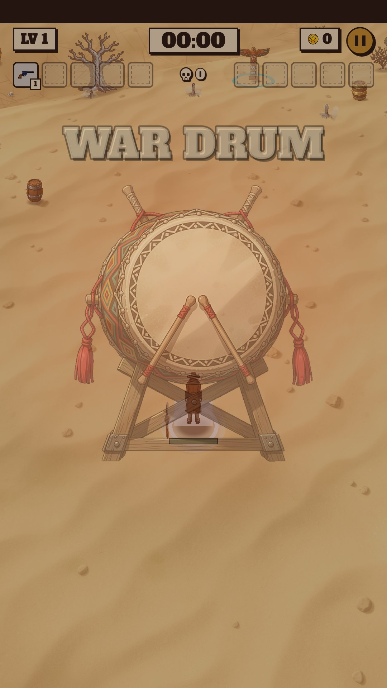
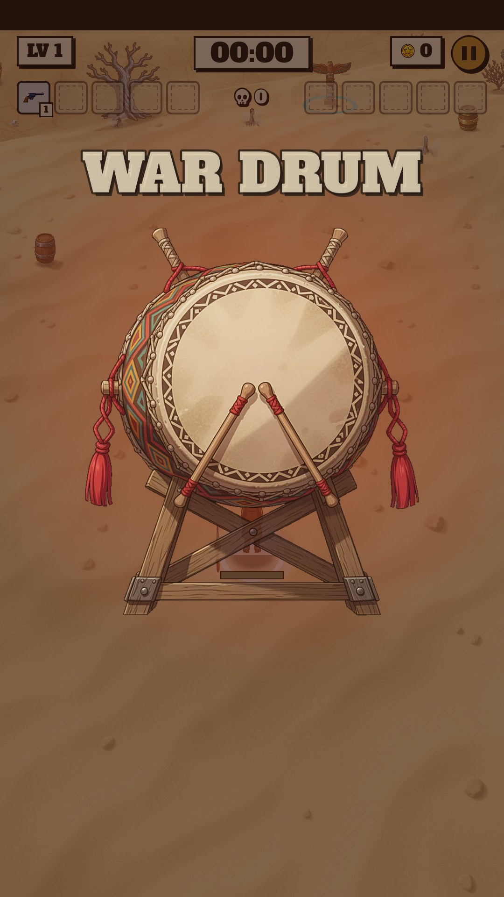

**When it shows:** using the War Drum on the map.

**Its job:** A 2.2-second drum show that stops time and announces a 15-second boost.

**On it now:**

- Time stops, the sound effects stop and the music holds; the drum fades in centre screen, squashing and springing on each slap, waves and ink slap lines from each hit.
- The last big hit flashes the screen and names the boost: '×2 DAMAGE · ×2 ATTACK SPEED · +15% SPEED' and knockback.
- Then the run goes on with a drum-red HUD plate counting the boost's 15 seconds. It cannot be skipped.

**Must still do (how is open):**

- The boost said in words, and how long it lasts.

---

# 18 · Pause

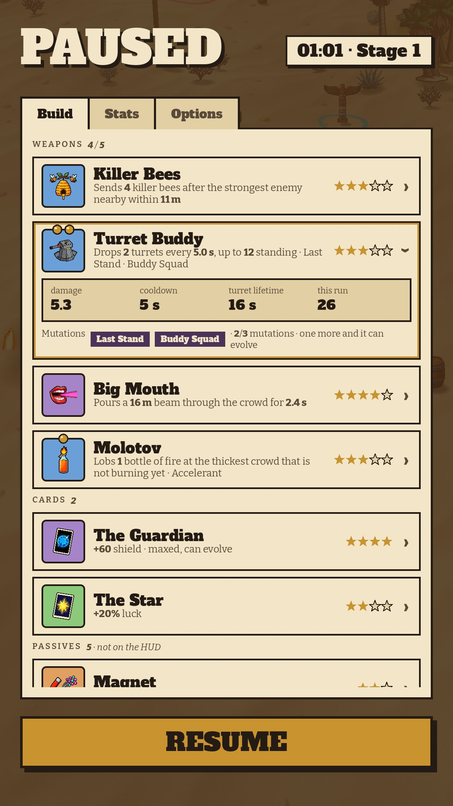
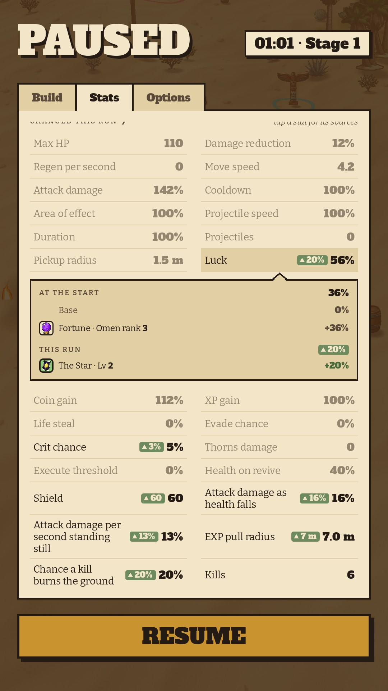
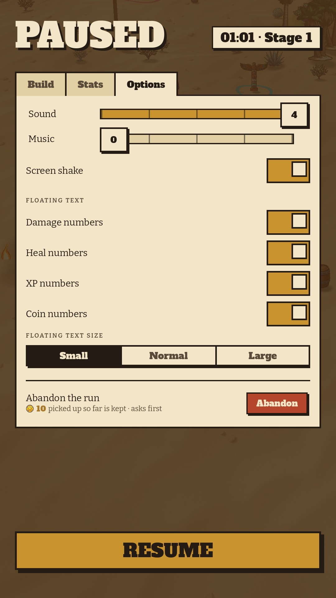
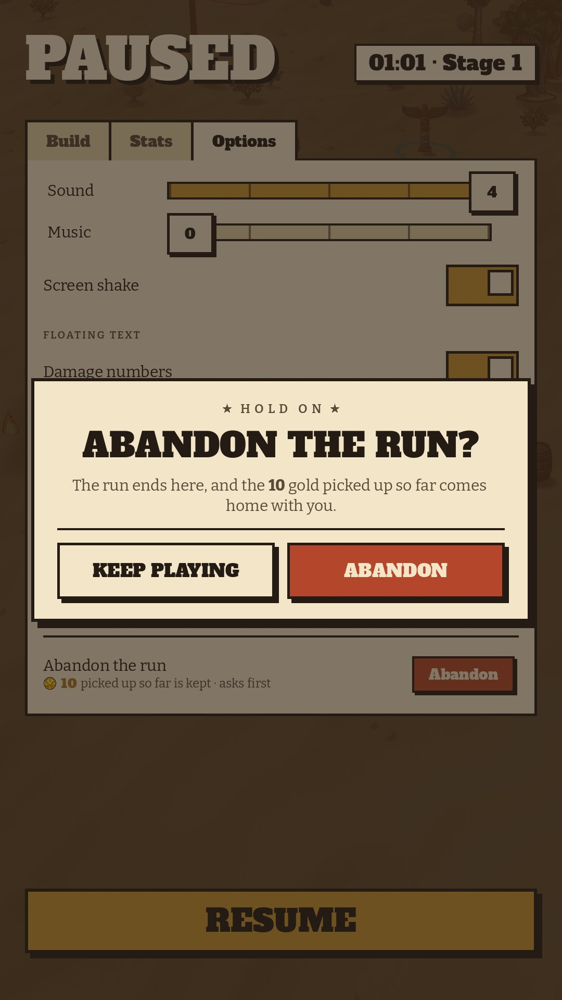

**When it shows:** a tap on the HUD's top strip or pause disc, or the app leaving the screen.

**Its job:** Look at the build and the stats, change a few options, or abandon the run.

**On it now:**

- 'PAUSED' and '<clock> · Stage N' (or 'Endless'); tabs Build / Stats / Options; RESUME.
- Build: Weapons (n / 5), Cards (n / 5), Passives ('n · not on the HUD'), Perks; each row the plate, stars and what it does; a row opens on its numbers, its mutation chips and what evolving still needs.
- Stats: 'Changed this run', two columns of every stat with change pills (sage better, rock worse) since the run's start; a cell opens its sources card ('At the start': base, hero, Upgrade board; 'This run': cards, items, perks, mutations, levels, Totem gifts, the Stranger, timed buffs), each with its icon.
- Options: sound and music, screen shake, the floating numbers, and Abandon (a 'Hold on' question: the gold picked up so far comes home).

**Must still do (how is open):**

- The whole build and where every stat comes from.
- A few options; abandon with the gold kept.

**We suspect:**

- The Stats tab is the densest screen in the game.

---

# 19 · Down!

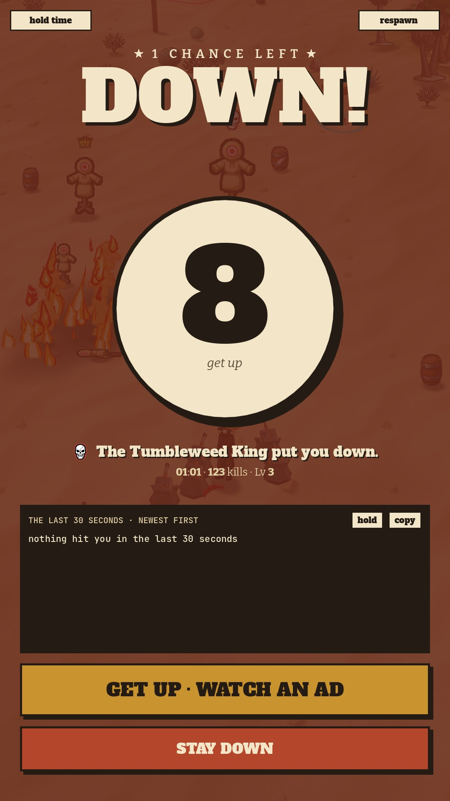

**When it shows:** the hero's health reaches zero.

**Its job:** Get up once or end the run.

**On it now:**

- A rock dim, 'N CHANCE(S) LEFT', DOWN!; a paper disc counting down 8 seconds with 'get up', ticking in the last three.
- '<killer> put you down.' with its badge; '<clock> · N kills · Lv N'; 'Stay down and the N gold still comes home.'
- GET UP · WATCH AN AD (a stand-in: no ad plays yet; revives with a blast that clears round him; locked with NO CHANCES LEFT) and STAY DOWN (a 'Hold on' question). The gold revive is gone (pass 77).
- Phoenix Feather, when held, stands him up by himself instead (banner PHOENIX FEATHER).

**Must still do (how is open):**

- Who killed him, how many chances are left, get up or stay down.
- The gold comes home either way.

**We suspect:**

- 'WATCH AN AD' with no ad behind it.

---

# 20 · Stage clear (the portal)

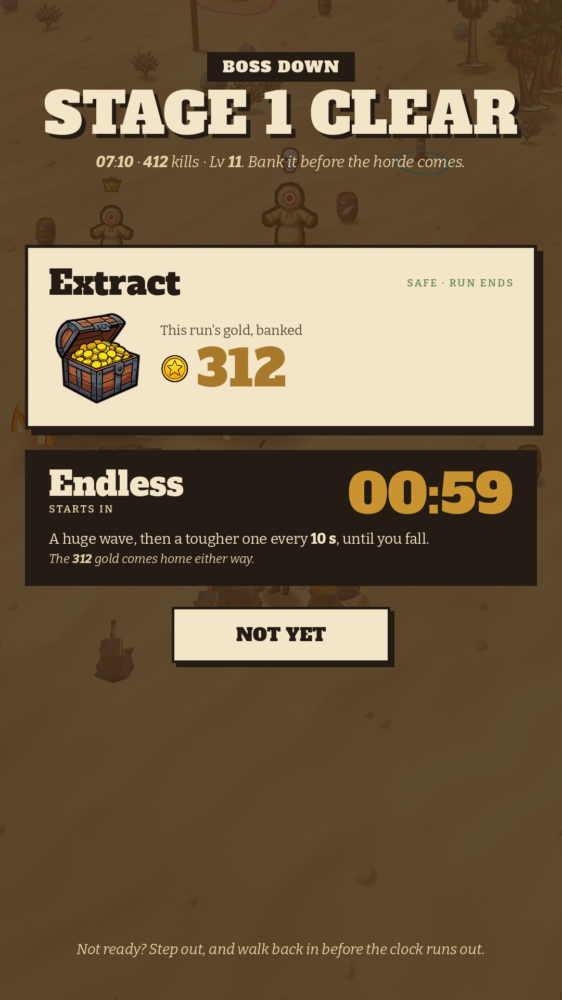
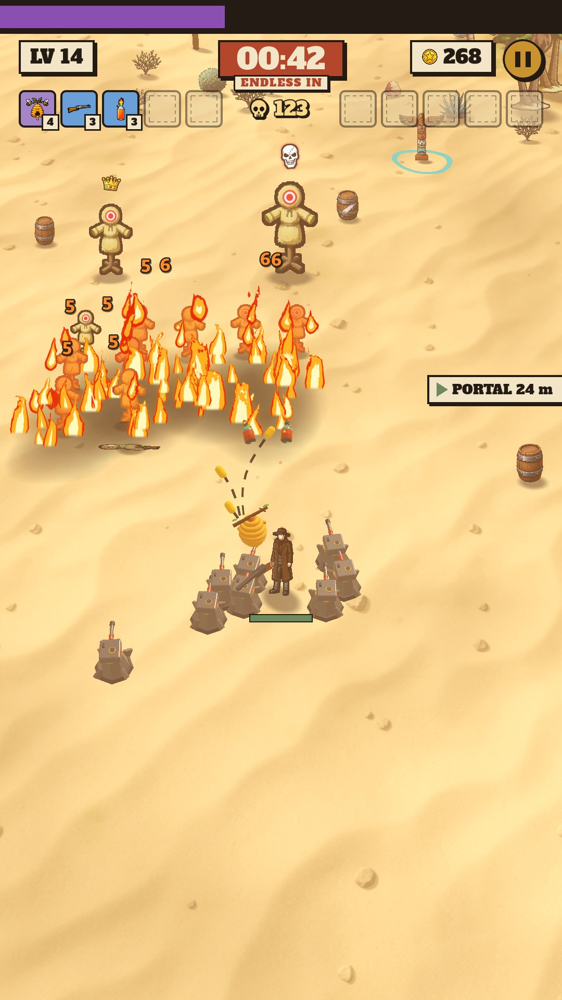

**When it shows:** walking into the portal after a stage's boss.

**Its job:** Leave with the run's gold before Endless, or keep fighting.

**On it now:**

- A BOSS DOWN tag and 'STAGE N CLEAR'.
- The Extract road: 'Safe · run ends' with the run's gold big in brass.
- The Endless card: 'Starts in' with the seconds counting down (rock in the last ones), what Endless is, 'The N gold comes home either way.'
- NOT YET: the run goes on ('The portal waits'); it asks again on the next step in. The countdown keeps running behind it; at zero it closes itself and Endless starts (an ENDLESS banner, then a wave every 10 seconds, the clock showing WAVE n).
- There is no 'next stage' road since pass 87: each stage is its own run.

**Must still do (how is open):**

- Extract or stay, and how long is left to choose.

---

# 21 · Results

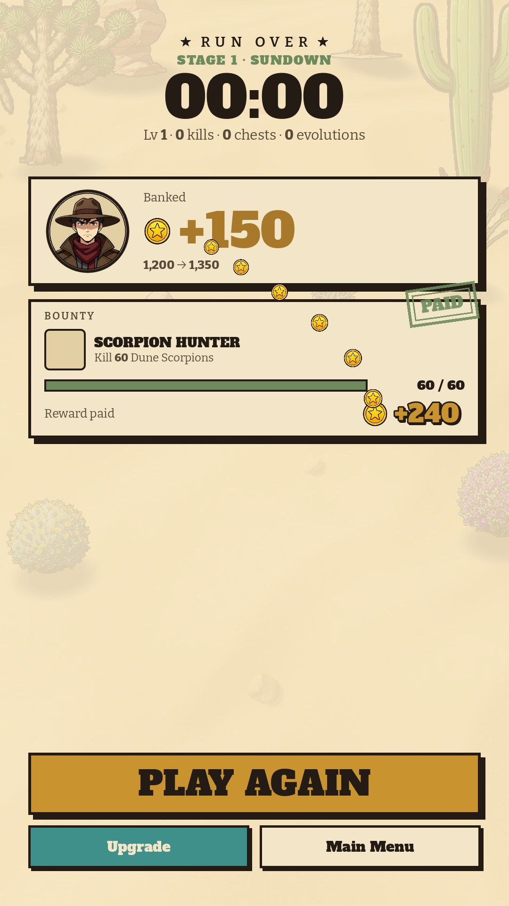
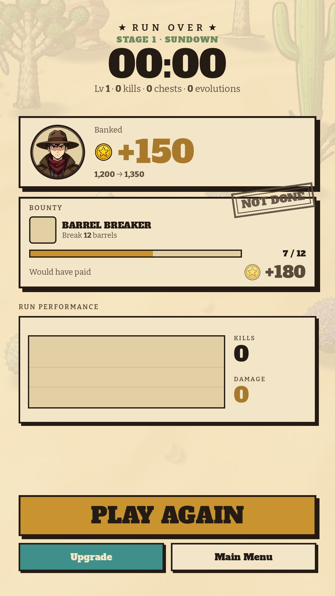
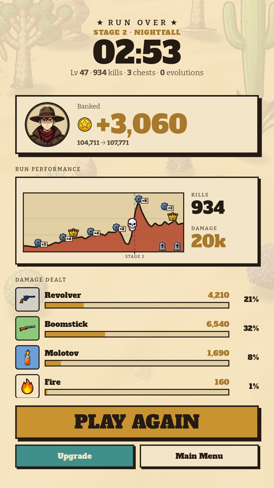

**When it shows:** after any run ends (extract, staying down, abandoning, falling in Endless).

**Its job:** Tell the run's story: the gold banked, the kills and damage over time, the bounty, and what was unlocked.

**On it now:**

- Star line (Extracted / Run over / Fell in Endless), the stage line ('STAGE 1 · SUNDOWN · BEATEN') in its colour, the run time big, 'Lv N · N kills · N chests · N evolutions'.
- The hero's badge and 'Banked' counting up along the run's purse curve, the purse before and after; a NEW BEST seal.
- Run performance: the kills chart drawn left to right with badges (a grave for each fall, a skull per boss, a crown per Elite, a gear per special), Kills and Damage counters, then 'Damage dealt' rows per source arriving as the line reaches the moment each joined.
- The bounty (pass 116): after the banked count the poster's panel fades in, its bar counts up to how far the run came, a stamp lands (PAID / FAILED / NOT DONE) and the reward shows as a coin and a gold '+N'; a paid one flies coins into Banked, which ticks up by N.
- 'Unlocked this run' with UNLOCKED or FOR SALE stamps; 'Unlock progress' bars filling (this run's part in sage).
- PLAY AGAIN (the same stage and hero), Upgrade, Main Menu. A tap hurries the show, a second ends it. A survey card may follow (see its page).

**Must still do (how is open):**

- Gold banked and why, the run's arc, the bounty's result, what opened.

**We suspect:**

- The show is long; most players will tap through it.

**A question for you:**

- What order would you play it in?

---

# 22 · Play-data question and surveys

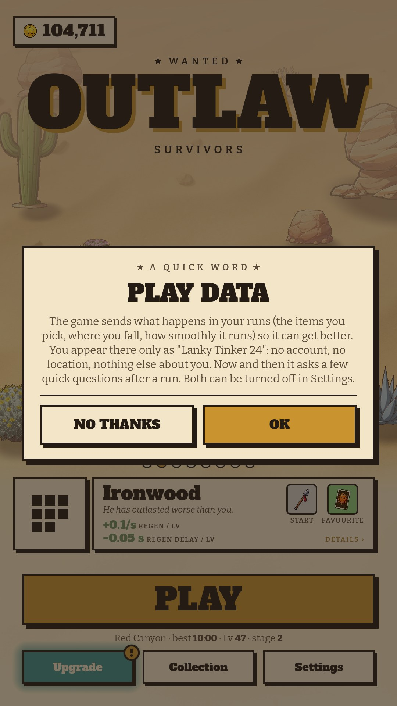
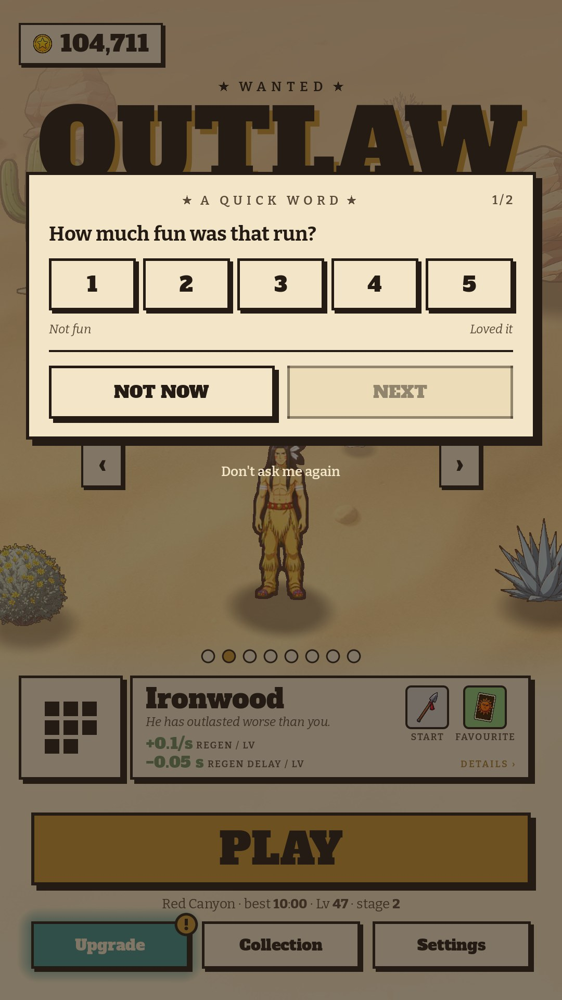

**When it shows:** the first launch (over the title), and now and then after a run (over Results).

**Its job:** Ask once whether anonymous play data may be sent; ask a few questions after a run now and then.

**On it now:**

- PLAY DATA under 'A quick word': what is sent (the items you pick, where you fall, how smoothly it runs), that the player appears only as a generated name (e.g. 'Dusty Coyote 41'); NO THANKS / OK. Nothing is sent until it is answered.
- A survey card (written in PostHog): '1 / 3', the question, a rating row, choices or a text box; NEXT / SEND, NOT NOW, and 'Don't ask me again' under the card. At most one every three runs, never twice a session.

**Must still do (how is open):**

- A clear yes or no to data, and an easy way out of every question.

---

# 23 · Developer menu and debug arena (testers only)

**When it shows:** only for us: the developer menu (hold Settings' version line) and ARENA in debug mode.

**Its job:** Every test switch and readout in one ink list, and a test room for every creature, item, hero, look and drop. Not for players.

**On it now:**

- The developer menu: ink background, mono type; the arena, the debug switches, frame rate, the camera-cutout preview, analytics and survey tools, the save file's state.
- The arena: the map and the hero with nothing coming unless asked; a quick column on the right (ARENA, AGAIN, CLEAR, WAVES, LV +1) and a bottom sheet with ENEMY, WAVES, ITEMS, HERO, DROPS, WORLD and SHOTS tabs; the old UiKit look.
- Neither exists in the production build.

**Must still do (how is open):**

**A question for you:**

- Low priority: no redesign needed. Flag anything from it that leaks into the player's screens.
